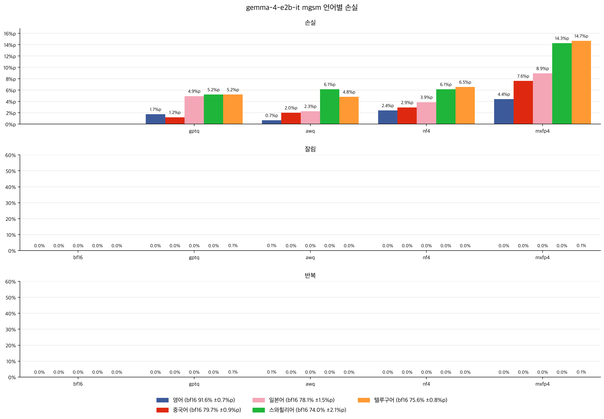
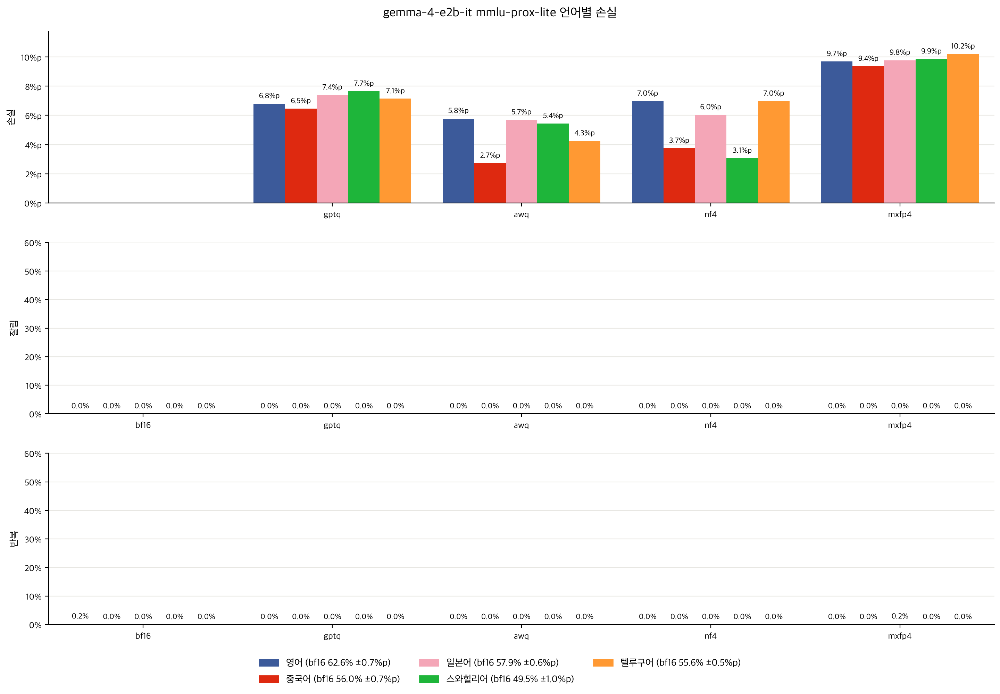
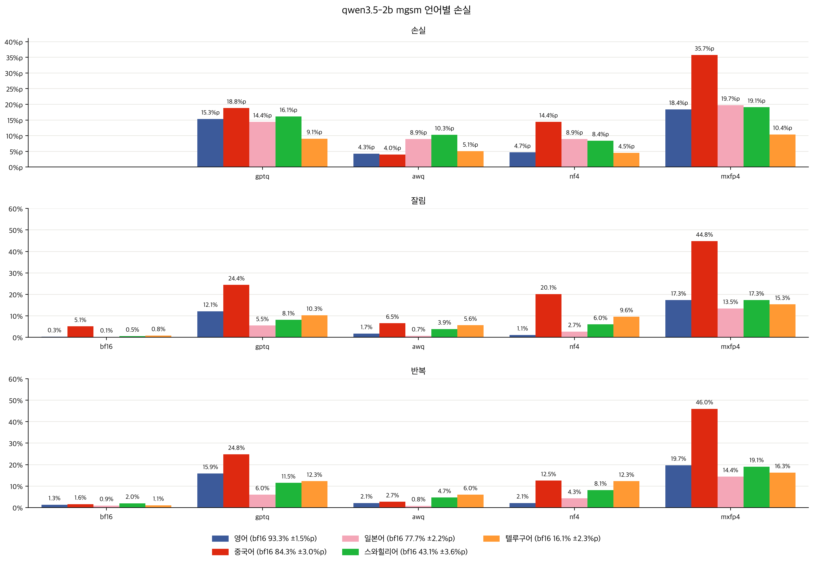
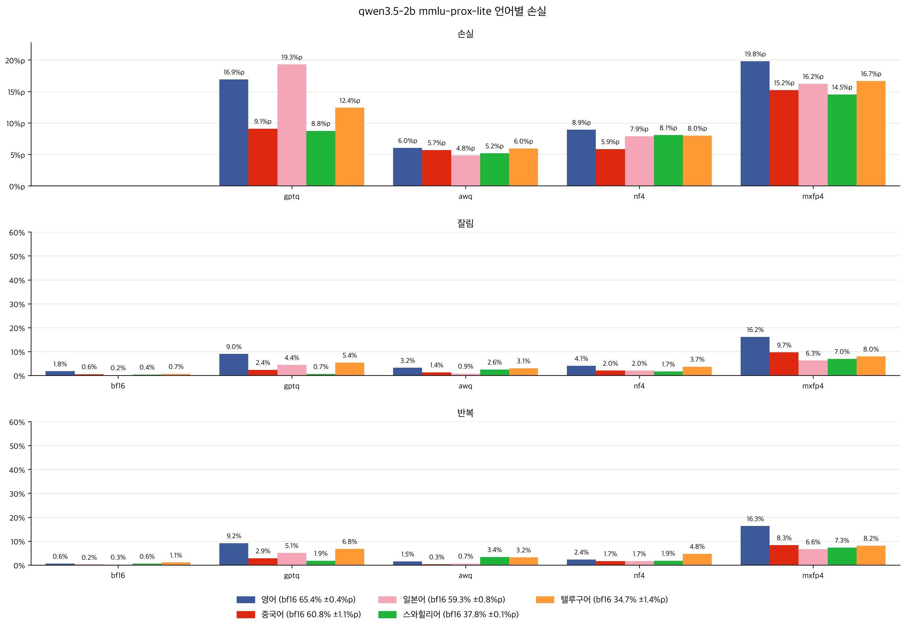
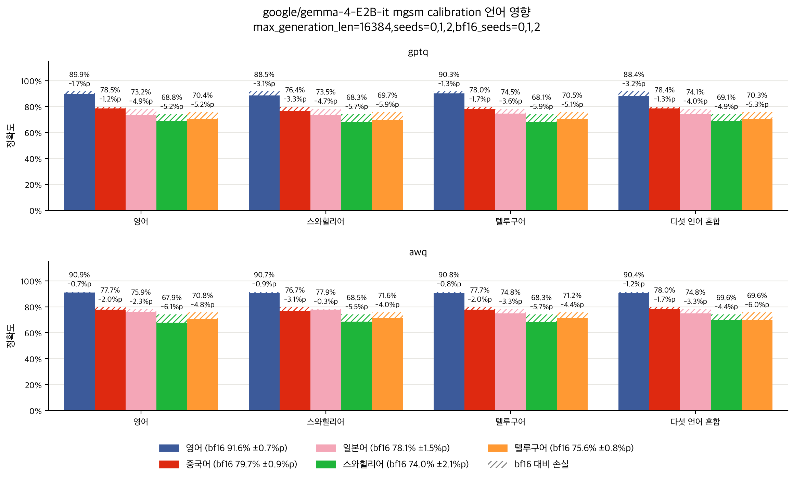
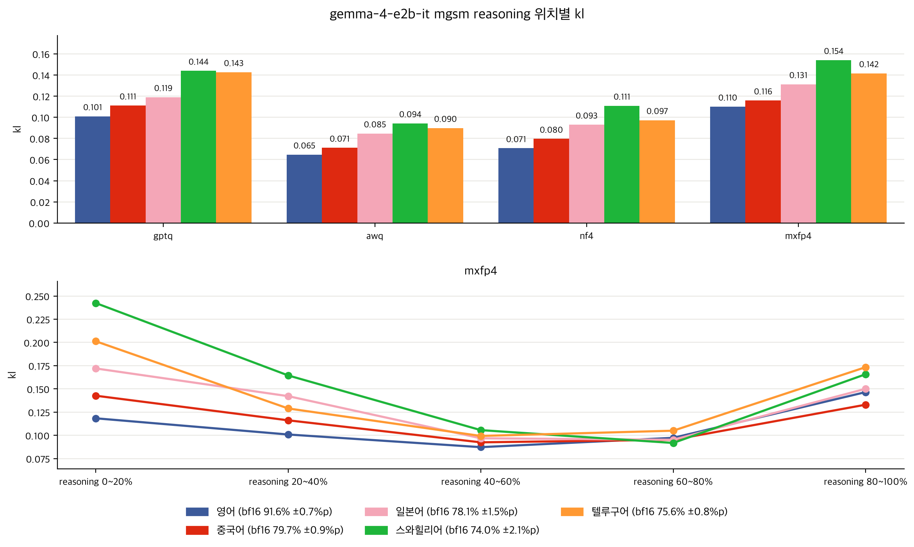

# 전체 실험
- 공통 설정은 [README](README.md#공통-설정)

### 언어별 손실
- [the multilingual quantization tax](https://arxiv.org/abs/2608.09941)의 언어별 손실이 thinking mode를 켜도 나타나는지 확인
- bf16과 양자화 모델로 mgsm과 mmlu-prox-lite를 풀고, 언어마다 손실 비교
#### 설정
- 잘림: 최대 생성 길이에 닿고 틀린 문제
- 반복: reasoning 또는 response 끝에서 200~150번째 글자 50개가 그 앞에 5번 이상 나오는 문제
- mmlu-prox-lite는 bf16 seed 0, 1, 양자화 모델 seed 0
#### 결과

- gemma mgsm에서, 스와힐리어와 텔루구어가 가장 많이 잃음
- 양자화 방법 중에서는 mxfp4가 가장 많이 잃음
- mmlu-prox-lite에서는, 영어보다 눈에 띄게 더 잃는 언어가 없음
- qwen은 양자화하면 많이 잘리고, 잘린 문제는 대부분 반복
- gemma는 거의 잘리지 않음
- 따라서 반복 없이 언어별 손실만 보려고, 이후 실험은 gemma mgsm만 사용

### calibration 언어별 손실
- gptq와 awq는 calibration 언어에 따라 손실이 달라질 수 있음
- 해당 언어로도 calibration해 손실 비교
#### 설정
- 양자화 방법은 gptq, awq
- calibration 언어는 영어, 스와힐리어, 텔루구어, 다섯 언어 혼합
- 다섯 언어 혼합은 언어마다 chunk 25~26개
#### 결과

- gptq와 awq 모두, 해당 언어나 다섯 언어 혼합으로 calibration해도 스와힐리어와 텔루구어 손실이 눈에 띄게 줄지 않음
- 언어별 손실에서도 calibration이 없는 mxfp4가 가장 많이 잃음
- 따라서 calibration 언어는 손실의 원인이 아님

### reasoning 위치별 kl
- 양자화 모델의 예측이 reasoning의 어디서 bf16과 가장 달라지는지 확인
- bf16 reasoning을 bf16과 양자화 모델에 똑같이 넣고, reasoning token마다 다음 token 예측의 kl 비교
#### 설정
- reasoning 위치: 문제마다 reasoning token을 5등분한 구간
- kl은 문제마다 token 평균을 낸 뒤 문제 평균
- reasoning은 bf16 seed 0
- 문제는 모든 bf16 seed가 맞힌 문제만
- reasoning 위치별 kl은 mxfp4만
#### 결과

- 스와힐리어와 텔루구어에서, 영어와의 kl 차이가 reasoning 위치 0~20%에서 가장 큼
- kl이 큰 언어가 손실도 큼
- 그러나 양자화 방법끼리는 그렇지 않음, gptq는 kl이 크지만 손실은 작음
- 따라서 스와힐리어와 텔루구어의 손실은 reasoning 앞부분에서 생길 수 있음

### 오류 유형

### understanding 삽입

### reasoning 앞부분 길이별 삽입

### 영어 understanding 삽입

### 영어 question 삽입

### bf16 번역 삽입

### 영어 understanding finetune

### 영어 question finetune

### 영어 question과 reasoning finetune

### qat
