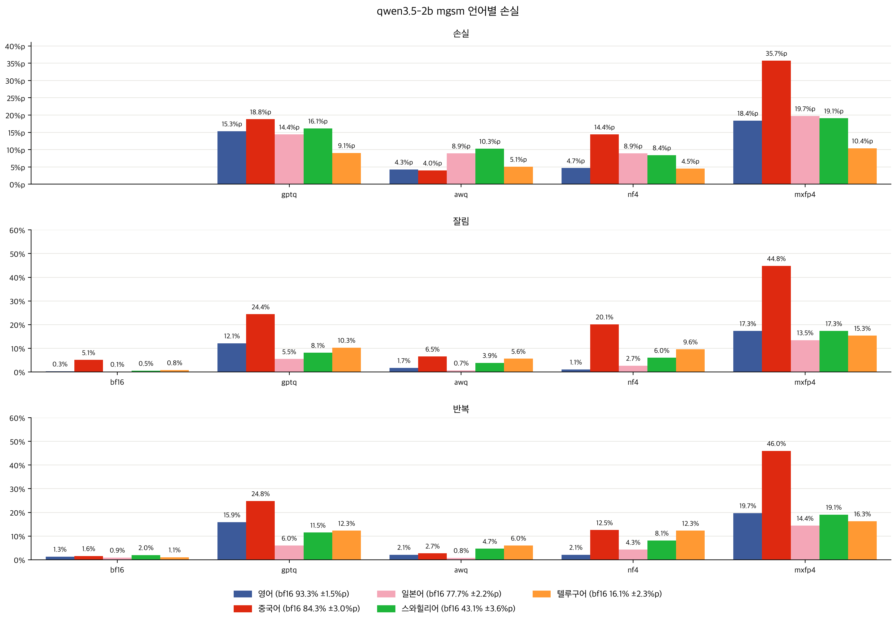
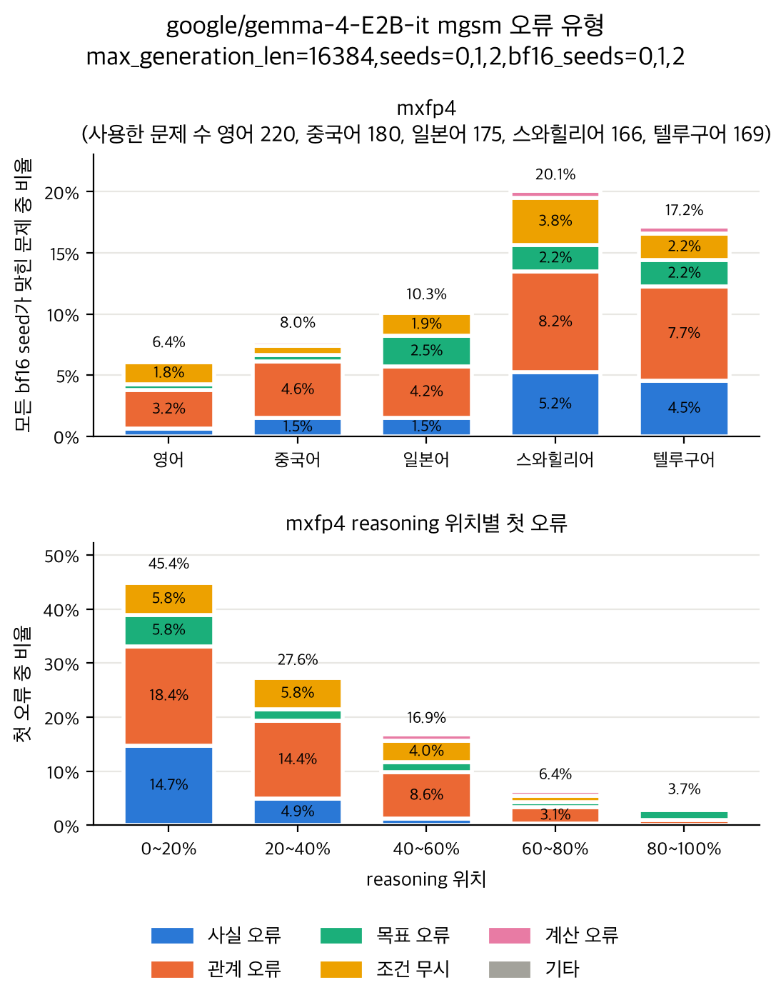
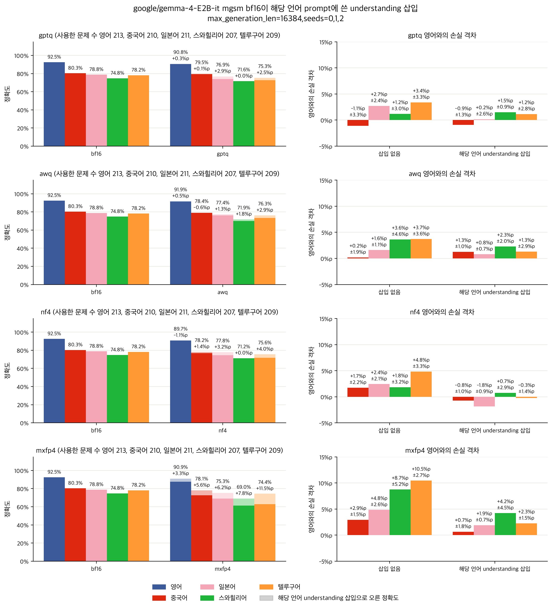
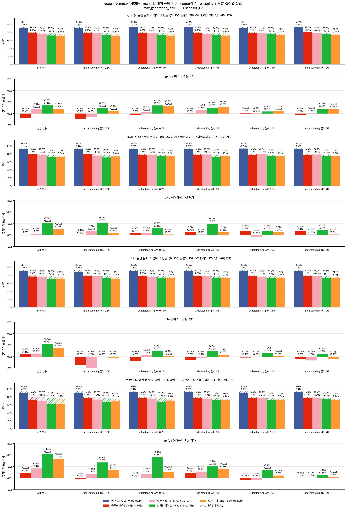
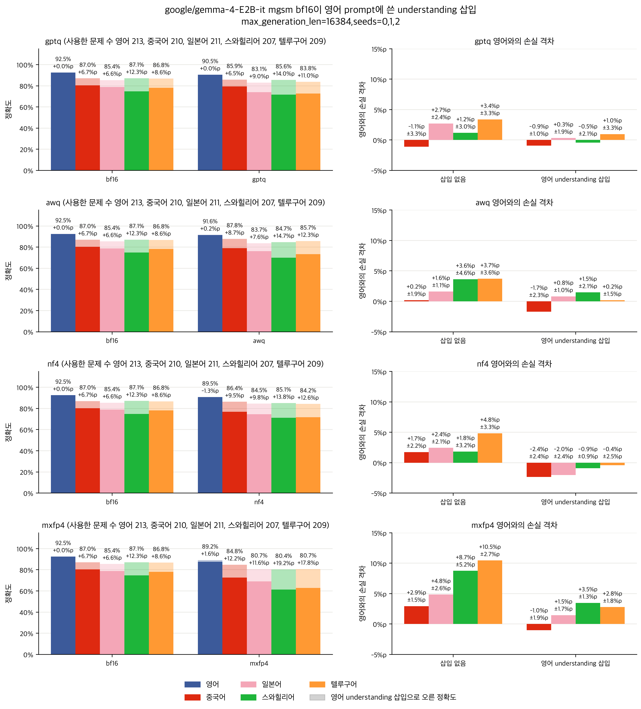
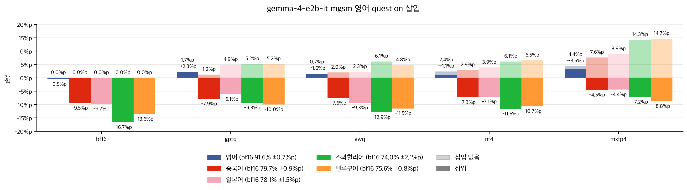
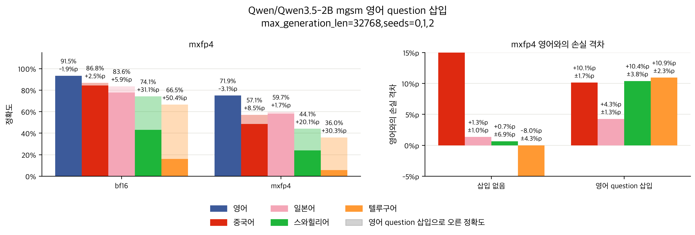
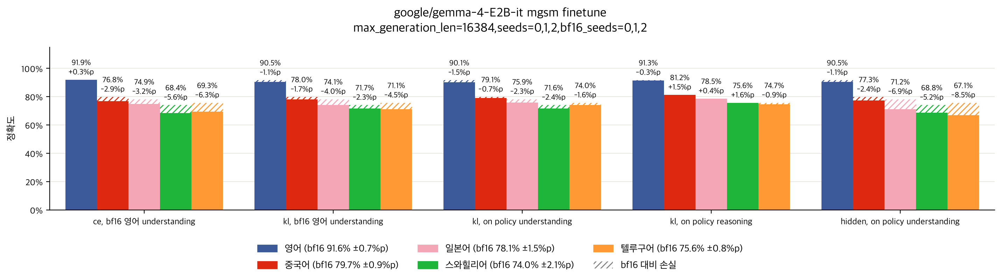

# multilingual quantization

## 배경

[the multilingual quantization tax](https://arxiv.org/abs/2608.09941)는 양자화하면 저자원 언어와 일부 비라틴 문자 언어가 더 많이 잃는다고 보고한다. 다만 nf4 하나로, thinking mode를 끄고, 한 번만 돌린 결과이다. 영어가 모국어가 아닌 한국인으로서 공감되는 문제라, 같은 현상을 다시 확인하고 그 손실이 어디서 생기는지 살펴본다.

## 요약
- thinking mode를 켠 gemma에서, 언어별 양자화 손실은 mgsm에서만 나타나고 스와힐리어와 텔루구어가 가장 많이 잃음
- 이 손실은 calibration 언어 때문이 아니라, 주로 reasoning 앞부분에서 question을 이해하는 understanding(reasoning의 약 30%)에서 생김
- understanding만 bf16 것으로 바꿔도 mxfp4 손실이 절반 넘게 줄고, 영어로 이해한 understanding이나 영어 question을 넣으면 bf16 해당 언어 정확도보다 높아짐
- 따라서 양자화 손실의 병목은 해당 언어 question 이해

## 관련 연구

#### [the multilingual quantization tax](https://arxiv.org/abs/2608.09941)
- nf4로 thinking mode를 끄고, 저자원 언어와 일부 비라틴 문자 언어가 더 많이 잃는다고 보고
- 이 프로젝트는 thinking mode를 켜고 여러 양자화 방법과 seed로 다시 확인

#### [why do multilingual reasoning gaps emerge in reasoning language models](https://arxiv.org/abs/2510.27269)
- bf16 reasoning 모델에서, reasoning 시작에 gold 영어 번역을 넣으면 언어 간 차이가 대부분 사라져, 차이가 주로 입력 이해에서 생긴다고 보고
- 이 프로젝트는 같은 방법을 양자화 모델에 적용하고, 손실이 생기는 위치를 understanding까지 좁힘

#### [how does quantization affect multilingual llms](https://arxiv.org/abs/2407.03211)
- 양자화하면 비라틴 문자 언어가 가장 많이 잃고, 수학 추론이 가장 빨리 무너진다고 보고
- 이 프로젝트는 thinking mode를 켠 모델에서, 손실이 reasoning의 어디서 생기는지 봄

## 실험

### 공통 설정

#### 용어
- prompt: instruction과 question
- reasoning: thinking mode에서 쓴 텍스트
- response: reasoning 뒤 텍스트
- 해당 언어: 문제와 같은 언어
- 손실: bf16 정확도에서 양자화 모델 정확도를 뺀 값
- 영어와의 손실 격차: 해당 언어 손실에서 영어 손실을 뺀 값
- seed 노이즈: seed 사이의 표준편차, 그림의 ± 값

#### 모델
- 모델은 qwen3.5-2b와 gemma-4-e2b-it, thinking mode를 켜고 bf16과 비교
- 양자화는 language model layer의 linear weight만 4 bit로
- group size는 gptq와 awq 128, nf4 64, mxfp4 32
- gptq와 awq는 영어 wikipedia 2048 token chunk 128개로 calibration

#### 생성
- vllm 0.30.0, temperature 1.0, top-p 0.95
- qwen은 top-k 20, presence penalty 1.5, 최대 생성 길이 32768
- gemma는 top-k 64, presence penalty 0, 최대 생성 길이 16384
- 따로 적지 않으면 seed 0, 1, 2 평균

#### 평가
- 언어는 영어, 중국어, 일본어, 스와힐리어, 텔루구어
- 문제는 언어마다 mgsm 250개, mmlu-prox-lite 588개, 해당 언어 prompt로 zero shot
- instruction은 mgsm은 [simple-evals](https://github.com/openai/simple-evals/blob/main/mgsm_eval.py), mmlu-prox-lite는 [lm-evaluation-harness](https://github.com/EleutherAI/lm-evaluation-harness/blob/main/lm_eval/tasks/mmlu_prox/lang_libs.py)에서 가져옴
- 채점은 response만

### 언어별 손실 검증

[the multilingual quantization tax](https://arxiv.org/abs/2608.09941)가 보고한 언어별 손실이 thinking mode를 켜고 여러 양자화 방법과 seed로 돌려도 나타나는지 먼저 확인한다.

bf16과 양자화 모델로 mgsm과 mmlu-prox-lite를 풀고, 언어마다 손실을 비교한다. 손실이 답을 틀려서인지 생성이 끝나지 않아서인지 보려고 잘림과 반복도 센다. mmlu-prox-lite는 언어마다 손실이 비슷해 보여 seed를 줄인다.

#### 설정
- 잘림: 최대 생성 길이에 닿고 틀린 문제
- 반복: reasoning 또는 response 끝에서 200~150번째 글자 50개가 그 앞에 5번 이상 나오는 문제
- 모델은 qwen, gemma, 벤치마크는 mgsm, mmlu-prox-lite
- 양자화 방법은 gptq, awq, nf4, mxfp4
- mmlu-prox-lite는 bf16 seed 0, 1, 양자화 모델 seed 0

#### 요약

- **gemma mgsm에서, 스와힐리어와 텔루구어가 가장 많이 잃음**
- 양자화 방법 중에서는 mxfp4가 가장 많이 잃음
- gemma는 거의 잘리지 않음, 따라서 손실은 대부분 답을 틀려서 생김
- **mmlu-prox-lite에서는, 영어보다 눈에 띄게 더 잃는 언어가 없음**
- qwen은 양자화하면 많이 잘리고 그 대부분이 반복, bf16에서도 스와힐리어와 텔루구어가 약함

### calibration 언어 영향

gptq와 awq는 calibration 데이터로 양자화하기 때문에, calibration 언어가 손실에 영향을 줄 수 있다. 그래서 해당 언어로 calibration해 본다.

gptq와 awq를 영어, 스와힐리어, 텔루구어, 다섯 언어 혼합으로 각각 calibration하고, 영어로 calibration한 모델과 mgsm 정확도를 비교한다. 이 실험부터는 반복이 적은 gemma와, 언어 차이가 나타난 mgsm만 쓴다.

#### 설정
- 모델은 gemma, 벤치마크는 mgsm
- 양자화 방법은 gptq, awq
- 다섯 언어 혼합은 영어, 중국어, 일본어, 스와힐리어, 텔루구어 chunk를 25~26개씩

#### 요약

- **gptq와 awq 모두, 해당 언어나 다섯 언어 혼합으로 calibration해도 스와힐리어와 텔루구어 손실이 눈에 띄게 줄지 않음**
- calibration이 없는 mxfp4가 가장 많이 잃음, 따라서 calibration 언어는 손실의 주된 원인이 아님

### reasoning 위치별 bf16과의 kl

양자화 모델의 예측이 reasoning의 어디서부터 bf16과 달라지는지 한 번 확인해 본다.

모든 bf16 seed가 맞힌 문제에서 bf16이 쓴 reasoning을 bf16과 양자화 모델에 똑같이 넣고, reasoning token마다 두 모델의 다음 token 예측 사이 kl을 잰다. 손실이 가장 큰 mxfp4는 reasoning 위치별로도 나눠 본다.

#### 설정
- reasoning 위치: 문제마다 reasoning token을 5등분한 구간
- 모델은 gemma, 벤치마크는 mgsm
- 양자화 방법은 gptq, awq, nf4, mxfp4, reasoning 위치별 kl은 mxfp4만
- reasoning은 bf16 seed 0
- 문제는 모든 bf16 seed가 맞힌 문제만 사용

#### 요약

- **스와힐리어와 텔루구어에서, 영어와의 kl 차이가 reasoning 위치 0~20%에서 가장 큼**
- kl이 큰 언어가 손실도 큼, 그러나 양자화 방법끼리는 그렇지 않음 (gptq는 kl이 크지만 손실은 작음)

### 오류 유형

스와힐리어와 텔루구어는 영어와의 kl 차이가 reasoning 앞부분에서 가장 컸다. 그렇다면 양자화 모델이 왜 틀리는지 한 번 파악해 본다. 직접 읽기에는 오래 걸려 판정 모델로 확인하고, 결과는 참고 정도로만 본다.

모든 bf16 seed가 맞힌 문제 중 손실이 가장 큰 mxfp4가 틀린 reasoning을, 같은 문제의 mgsm 영어 원문, 해당 언어 question, 정답, bf16 reasoning과 함께 판정 모델에 넣는다. 판정 모델이 처음 틀린 줄과 오류 유형을 고르면, 그 줄의 reasoning 위치도 본다.

#### 설정
- 사실 오류: question의 숫자, 단위, 단어, 이름을 잘못 옮김
- 관계 오류: 양 사이의 관계를 잘못 이해함
- 목표 오류: 묻는 것과 다른 양을 구함
- 조건 무시: 주어진 조건을 없거나, 애매하거나, 상관없다고 보고 버림
- 계산 오류: 식은 맞지만 계산이 틀림
- 기타: 위에 없음
- 모델은 gemma, 벤치마크는 mgsm
- 양자화 방법은 mxfp4
- 판정 모델은 qwen3.5-27b
- 문제는 모든 bf16 seed가 맞힌 문제 중 mxfp4가 틀린 문제만 사용

#### 요약

- **스와힐리어와 텔루구어에서, 오류는 계산 오류가 아니라 대부분 사실 오류와 관계 오류**, 따라서 question을 잘못 이해한 것일 수 있음
- 첫 오류는 대부분 reasoning 위치 0~60%, 사실 오류는 대부분 0~20%에서 발생

### bf16이 해당 언어 prompt에 쓴 understanding 삽입

스와힐리어와 텔루구어의 오류는 대부분 question을 잘못 이해한 것이고, reasoning 앞부분에서 생겼다. [why do multilingual reasoning gaps emerge in reasoning language models](https://arxiv.org/abs/2510.27269)도 bf16에서 언어 간 차이가 주로 입력 이해에서 생긴다고 보고한다. 그렇다면 양자화로 이해가 더 손상된 것일 수 있어, reasoning 시작에서 question을 이해한 부분만 bf16이 쓴 것으로 바꿔 넣어 본다.

해당 언어 prompt 뒤, reasoning 시작에 같은 seed의 bf16이 해당 언어 prompt에 쓴 understanding을 넣고, 이어서 양자화 모델이 solving과 response를 쓴다. bf16은 자기 understanding을 받으면 결과가 거의 같아서, 넣지 않은 결과를 기준으로 쓴다. 영어 prompt에 쓴 understanding 삽입과 같은 문제로 비교하려고, 영어 bf16 reasoning에도 understanding이 있는 문제만 쓴다.

#### 설정
- understanding: reasoning 시작에서 목표와 주어진 정보를 정리하는 부분, 제목에 calculate, determine, compute, solve, perform, set up, formulate가 처음 나오는 단계 앞까지
- solving: understanding 뒤 reasoning
- 모델은 gemma, 벤치마크는 mgsm
- 양자화 방법은 gptq, awq, nf4, mxfp4
- understanding은 같은 seed의 bf16
- 문제는 해당 언어와 영어 bf16 reasoning 모두에 understanding이 있는 문제만 사용

#### 요약

- **mxfp4에서, understanding만 bf16 것으로 바꿔도 손실이 절반 넘게 줄어듦**, 따라서 앞서 말한 논문과 같이 양자화 모델에서도 이해가 주된 원인
- 영어와의 손실 격차도 줄어듦, 따라서 스와힐리어와 텔루구어는 양자화로 이해가 특히 더 손상됨
- gptq, awq, nf4는 손실이 작아 seed 노이즈와 구분하기 어려움

### bf16이 해당 언어 prompt에 쓴 reasoning 앞부분 길이별 삽입

understanding만 bf16 것으로 바꿔도 손실이 절반 넘게 줄었다. 그러나 understanding 내용 덕분인지, 단지 bf16 reasoning 앞부분을 넣어 준 덕분인지는 아직 모른다. 그래서 대조군으로 bf16 reasoning 앞부분을 understanding보다 짧게, 또 길게 넣어 본다.

bf16이 해당 언어 prompt에 쓴 reasoning을 understanding 길이의 여러 배수에서 잘라 넣고, 이어서 양자화 모델이 reasoning과 response를 쓴다. 배수끼리 같은 문제로 비교하려고 reasoning이 understanding의 2배 이상인 문제만 쓴다. 1배 근처에서 손실이 크게 줄고 그 뒤로 평평하면, 길이보다 understanding 내용이 중요하다.

#### 설정
- 모델은 gemma, 벤치마크는 mgsm
- 양자화 방법은 gptq, awq, nf4, mxfp4
- 자르는 길이는 understanding token 수의 0.5배, 0.75배, 1배, 1.5배, 2배
- reasoning은 같은 seed의 bf16
- 문제는 reasoning이 understanding token 수의 2배 이상인 문제만 사용

#### 요약

- **mxfp4에서, 손실이 1배까지 크게 줄고 그 뒤로는 거의 그대로**, 따라서 길이보다 understanding 내용이 중요
- gptq, awq, nf4는 손실이 작아 seed 노이즈와 구분하기 어려움

### bf16이 영어 prompt에 쓴 understanding 삽입

bf16이 해당 언어 prompt에 쓴 understanding에는, bf16이 해당 언어를 영어보다 덜 이해하는 만큼이 그대로 남는다. 그렇다면 bf16이 영어 question을 보고 쓴 understanding을 넣으면 손실이 더 줄어드는지 확인해 본다.

해당 언어 prompt 뒤, reasoning 시작에 같은 seed의 bf16이 영어 prompt에 쓴 understanding을 넣고, 이어서 bf16 또는 양자화 모델이 solving과 response를 쓴다. 이번에는 bf16도 다른 understanding을 받으므로 bf16에도 넣는다. 해당 언어 prompt에 쓴 understanding 삽입과 같은 문제를 쓴다.

#### 설정
- 모델은 gemma, 벤치마크는 mgsm
- 양자화 방법은 gptq, awq, nf4, mxfp4
- understanding은 같은 seed의 bf16
- 문제는 해당 언어와 영어 bf16 reasoning 모두에 understanding이 있는 문제만 사용

#### 요약

- **모든 양자화 방법에서, 해당 언어 understanding보다 더 회복되고 bf16 해당 언어 정확도를 넘음**
- bf16도 해당 언어 정확도가 크게 오름, 따라서 해당 언어 question 이해는 bf16에서도 약점
- mxfp4의 영어와의 손실 격차도 줄어듦

### 영어 question 삽입

영어 understanding도 결국 bf16이 쓴 것이다. 그렇다면 [why do multilingual reasoning gaps emerge in reasoning language models](https://arxiv.org/abs/2510.27269)처럼 영어 question만 넣어 주고, 양자화 모델이 직접 이해해도 손실이 줄어드는지 확인해 본다.

해당 언어 prompt 뒤, reasoning 시작에 같은 문제의 영어 question을 넣고, 이어서 bf16 또는 양자화 모델이 reasoning과 response를 쓴다. 해당 논문과 달리 문장으로 감싸지 않고 원문만 넣으며, qwen에서도 bf16과 손실이 가장 큰 mxfp4로 확인한다.

#### 설정
- 영어 question: 같은 문제의 mgsm 영어 원문
- 모델은 gemma, qwen, 벤치마크는 mgsm
- 양자화 방법은 gemma에서 gptq, awq, nf4, mxfp4, qwen에서 mxfp4

#### 요약

- 해당 논문에서 bf16이 그랬던 것과 같이, 양자화 모델에서도 해당 언어 정확도가 크게 오름
- **gemma mxfp4에서, 영어 question만으로 bf16 해당 언어 정확도를 넘음**
- gemma mxfp4의 영어와의 손실 격차는 대부분 줄어듦, 그러나 스와힐리어는 절반쯤 남음
- qwen mxfp4는 많이 잘려 회복이 제한되고, 영어와의 손실 격차가 오히려 커짐

### 영어 understanding finetune

영어 question만 넣어 줘도 bf16 해당 언어 정확도를 넘었다. 그렇다면 넣어 주지 않아도 영어 question을 본 것처럼 이해하도록 학습할 수 있는지 확인해 본다. 양자화 모델을 바로 학습하면 손실을 회복한 것인지 이해가 나아진 것인지 구분할 수 없어, 먼저 bf16을 학습한다.

해당 언어 prompt 뒤, reasoning 시작에 bf16이 영어 prompt에 쓴 understanding을 넣고, 그 위치의 다음 token 예측만 학습한다. 학습 중인 모델이 직접 쓴 understanding이나 reasoning으로도 학습해 본다. 학습으로 더 맞힌 문제와 잃은 문제를 보려고, bf16이 맞힌 문제와 틀린 문제로도 나눠 본다.

#### 설정
- on policy: 학습 중인 모델이 해당 언어 prompt에 쓴 understanding 또는 reasoning
- 모델은 gemma, 벤치마크는 mgsm
- 학습 방법은 ce, kl, hidden, kl과 hidden은 영어 prompt를 받은 bf16에 맞춤
- 학습 언어는 중국어, 일본어, 스와힐리어, 텔루구어
- 학습 문제는 gsm8k train 4000개, bf16이 해당 언어로 맞힌 문제만 사용
- bf16이 맞힌 문제와 틀린 문제는 다른 두 bf16 seed로 나누고, 남은 seed로 채점

#### 요약

- **어떤 학습 방법도 bf16 해당 언어 정확도를 눈에 띄게 넘지 못함**
- bf16이 틀린 문제는 일부 맞히게 됨, 그러나 bf16이 맞힌 문제를 더 많이 잃음
- kl, on policy reasoning은 잃은 만큼 더 맞혀 bf16과 비슷
- *추측) bf16이 해당 언어로 맞힌 문제만 학습에 써서, 잘못 이해하던 것을 고치지 못함*
