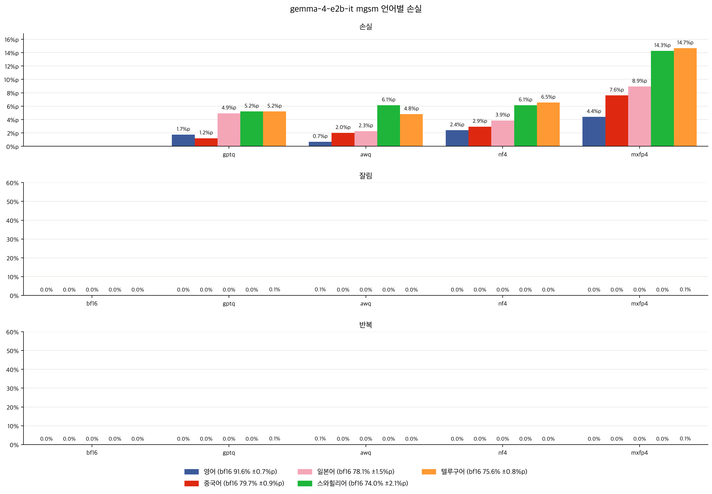
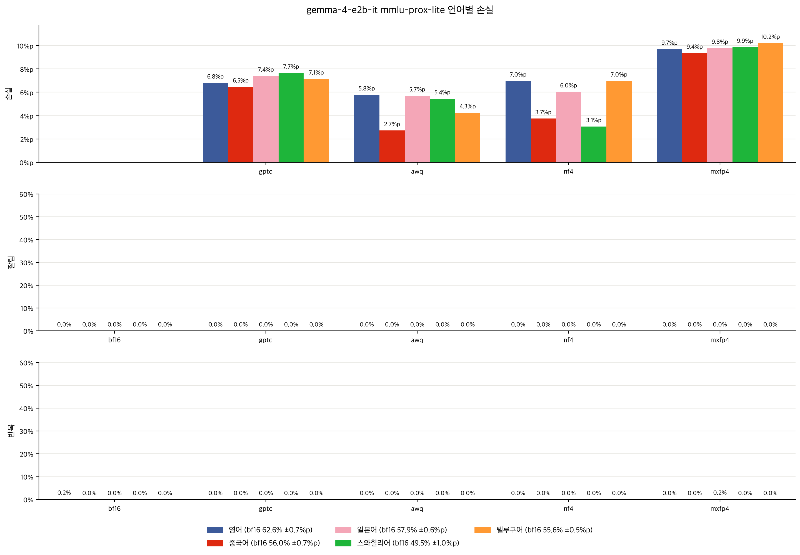
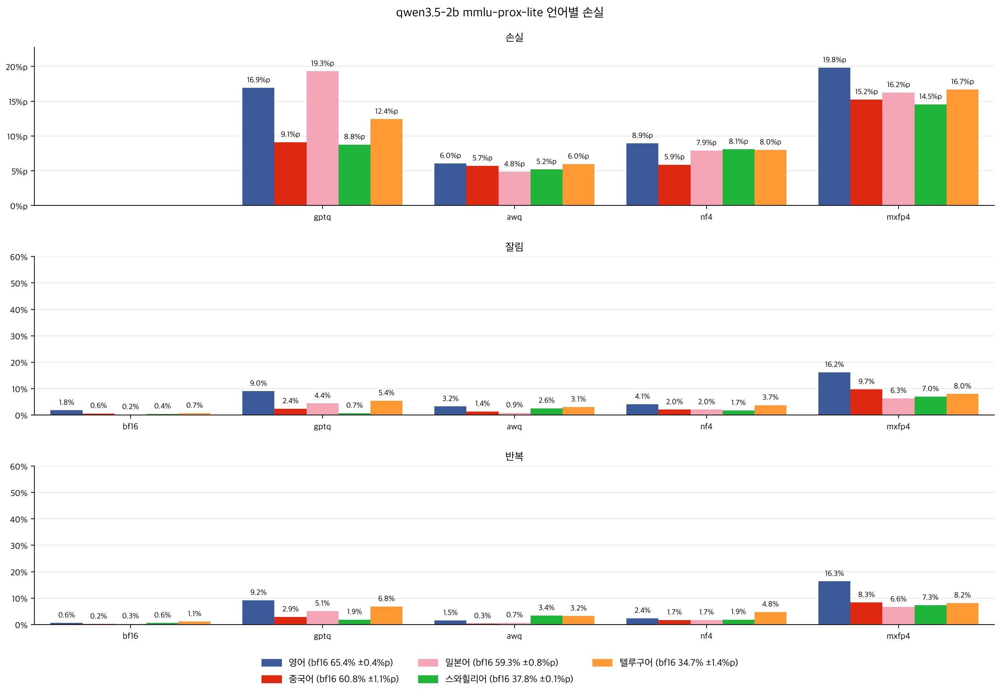
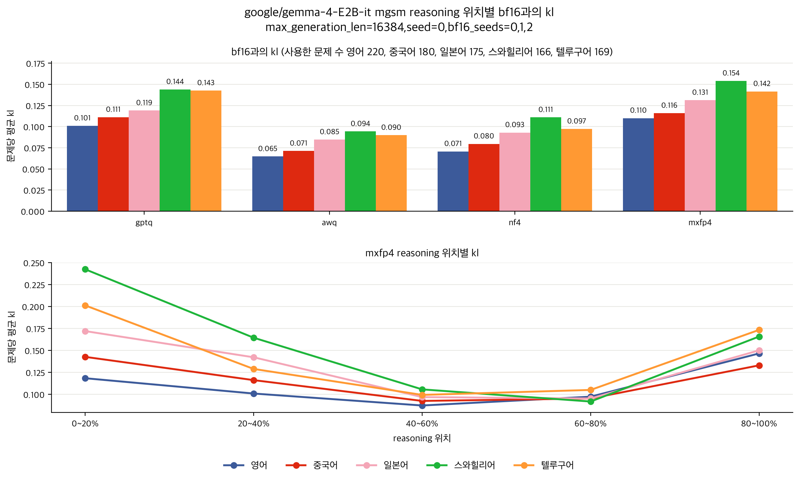
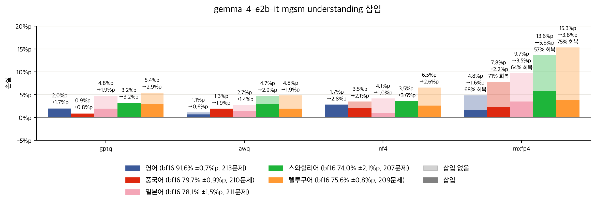
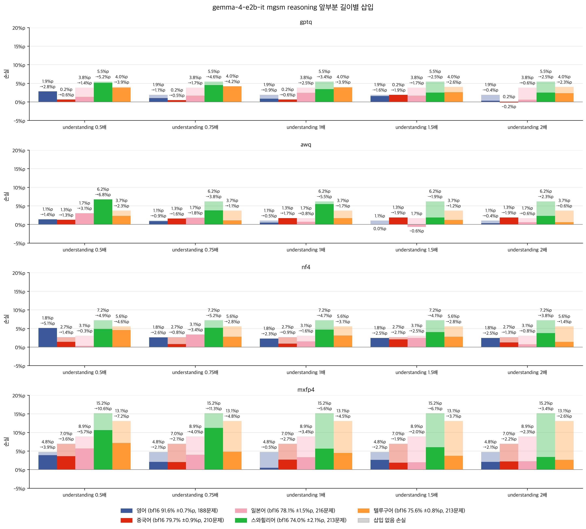
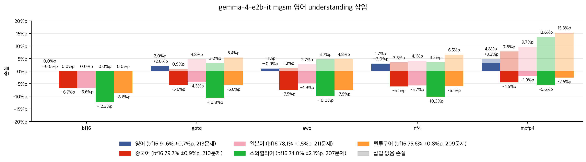
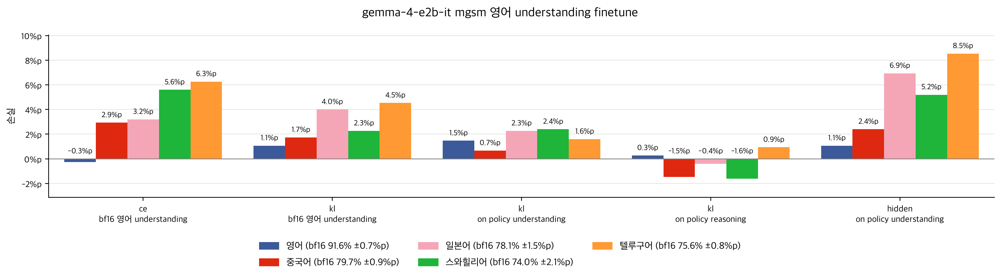
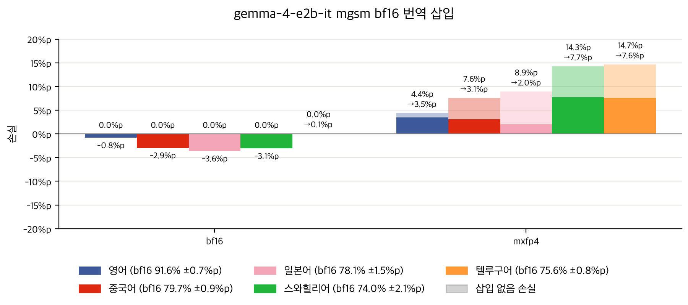
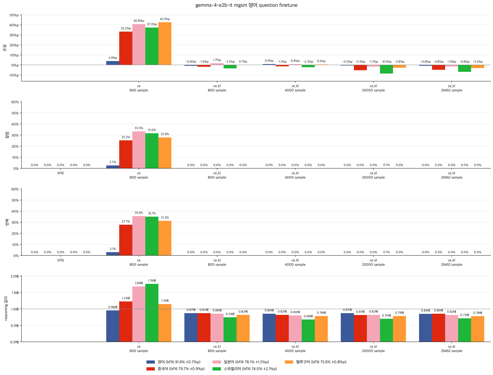

# multilingual quantization

## 배경
- 모델은 대부분 영어로 사전 학습되어, 양자화하면 영어 외 언어에서 더 잃을 수 있음
- [the multilingual quantization tax](https://arxiv.org/abs/2608.09941)는 이 손실을 보고함
- 다만 nf4 하나로, thinking mode를 끄고만 확인해 허술함
- 이 프로젝트는 thinking mode를 켜고 여러 양자화 방법으로 손실을 다시 확인
- 그 뒤 손실이 어디서 생기는지, 줄일 방법이 있는지 확인

## 요약
- gemma mgsm에서, 양자화하면 스와힐리어와 텔루구어가 가장 많이 잃음
- 이 손실은 주로 reasoning 앞부분의 understanding에서 생김
- 영어 understanding을 삽입하면 양자화 모델도 bf16을 넘음
- 영어 question을 삽입하면 더 크게 넘음
- 영어 question과 그 뒤 reasoning을 함께 finetune하면, 삽입 없이도 모든 언어에서 bf16을 넘음
- ce_kl로 qat하면 양자화 모델도 영어 외 언어에서 bf16을 넘음

## 관련 연구
#### [the multilingual quantization tax](https://arxiv.org/abs/2608.09941)
- 양자화하면 저자원 언어가 더 많이 잃는다고 보고
- 그러나 nf4 하나로, thinking mode를 끄고 확인
- 이 프로젝트는 thinking mode를 켜고 여러 양자화 방법으로 다시 확인
#### [why do multilingual reasoning gaps emerge in reasoning language models](https://arxiv.org/abs/2510.27269)
- bf16에서 reasoning 시작에 영어 question을 삽입하면 언어 간 차이가 대부분 사라진다고 보고
- 그러나 양자화 모델은 보지 않음
- 이 프로젝트는 같은 방법을 양자화 모델에 적용

## 공통 설정
- 각 실험의 설정에 따로 적지 않으면 아래 값을 사용
#### 용어
- bf16: 양자화하지 않은 원래 모델
- prompt: instruction과 question
- reasoning: thinking mode에서 쓴 text
- response: reasoning 뒤 text
- understanding: reasoning 앞부분에서 question을 이해하는 부분
- understanding 구분: 제목에 calculate, determine, compute, solve, perform, set up, formulate가 처음 나오는 단계 앞까지
- reasoning 위치: 문제마다 reasoning token을 5등분한 구간
- 해당 언어: question과 같은 언어
- 영어 question: 데이터셋에 있는 같은 문제의 영어 question
- 삽입: reasoning 시작에 넣고, 이어서 모델이 씀
- 손실: 삽입 없는 bf16의 해당 언어 정확도에서 정확도를 뺀 값
- 넘음: 손실이 0보다 작음, 즉 삽입 없는 bf16보다 정확도가 높음
- 잘림: 최대 생성 길이에 닿고 틀린 문제
- 반복: reasoning 또는 response 끝에서 200~150번째 글자 50개가 그 앞에 5번 이상 나오는 문제
- ce_kl: 영어 question은 ce, 그 뒤 reasoning은 같은 text를 받은 bf16에 kl로 맞추는 finetune
#### 모델
- qwen3.5-2b와 gemma-4-e2b-it, thinking mode를 켜고 bf16과 비교
- 양자화는 language model layer의 linear weight만 4 bit로
- 양자화 방법은 gptq, awq, nf4, mxfp4
- group size는 gptq와 awq 128, nf4 64, mxfp4 32
- gptq와 awq는 영어 wikipedia 2048 token chunk 128개로 calibration
- finetune은 중국어, 일본어, 스와힐리어, 텔루구어로, 양자화 대상과 같은 linear weight만
#### 생성
- vllm 0.30.0, temperature 1.0, top-p 0.95
- qwen은 top-k 20, presence penalty 1.5, 최대 생성 길이 32768
- gemma는 top-k 64, 최대 생성 길이 16384
- seed 0, 1, 2 평균, 그림의 ±는 seed 사이 표준편차
#### 평가
- 언어는 영어, 중국어, 일본어, 스와힐리어, 텔루구어
- mgsm 250문제와 mmlu-prox-lite 588문제를 해당 언어 prompt로 zero shot
- instruction은 [simple-evals](https://github.com/openai/simple-evals/blob/main/mgsm_eval.py)와 [lm-evaluation-harness](https://github.com/EleutherAI/lm-evaluation-harness/blob/main/lm_eval/tasks/mmlu_prox/lang_libs.py)에서 가져옴
- 채점은 response만

## 실험

### 언어별 손실
- [the multilingual quantization tax](https://arxiv.org/abs/2608.09941)의 언어별 손실이 thinking mode를 켜도 나타나는지 확인
- mgsm과 mmlu-prox-lite에서 언어마다 손실 비교
#### 설정
- mmlu-prox-lite는 bf16 seed 0, 1, 양자화 모델 seed 0
#### 결과

- gemma mgsm에서, 스와힐리어와 텔루구어가 가장 많이 잃음
- 양자화 방법 중에서는 mxfp4가 가장 많이 잃음
- mmlu-prox-lite에서는, 영어 외 언어가 영어보다 눈에 띄게 더 잃지 않음
- qwen은 양자화하면 잘림과 반복이 함께 늘어남
- 따라서 이후 실험은 gemma mgsm만 사용

### calibration 언어별 손실
- [언어별 손실](#언어별-손실)에서, gptq와 awq는 영어로만 calibration해서 영어 외 언어가 더 잃을 수 있음
- calibration 언어를 바꿔 손실 비교
#### 설정
- calibration 언어는 영어, 스와힐리어, 텔루구어, 다섯 언어 혼합
#### 결과

- 어떤 calibration 언어로도 스와힐리어와 텔루구어 손실이 눈에 띄게 줄지 않음
- 따라서 calibration 언어는 손실의 원인이 아님

### reasoning 위치별 kl
- [calibration 언어별 손실](#calibration-언어별-손실)에서, calibration 언어는 손실의 원인이 아님
- 그렇다면 양자화 모델의 예측이 reasoning의 어디서 bf16과 가장 달라지는지 확인
- 같은 bf16 reasoning을 두 모델에 넣고, token마다 다음 token 예측의 kl 비교
#### 설정
- bf16 reasoning은 seed 0만
- 문제는 모든 bf16 seed가 맞힌 문제만
- reasoning 위치별 kl은 mxfp4만
#### 결과

- 스와힐리어와 텔루구어에서, 영어와의 kl 차이가 reasoning 위치 0~20%에서 가장 큼
- 따라서 손실은 reasoning 앞부분에서 생길 수 있음

### 오류 유형
- [reasoning 위치별 kl](#reasoning-위치별-kl)에서, 손실은 reasoning 앞부분에서 생길 수 있음
- 그렇다면 앞부분에서 무엇을 틀리는지, 판정 모델로 대략 확인
- 판정 모델이 mxfp4가 틀린 reasoning에서 처음 틀린 줄과 오류 유형을 고름
#### 설정
- 사실 오류: question의 숫자, 단위, 단어, 이름을 잘못 옮김
- 관계 오류: 양 사이의 관계를 잘못 이해함
- 목표 오류: 묻는 것과 다른 양을 구함
- 조건 무시: 주어진 조건을 없다고, 애매하다고, 또는 상관없다고 보고 버림
- 계산 오류: 식은 맞지만 계산이 틀림
- 기타: 위에 없거나 판정을 읽지 못함
- 판정 모델은 qwen3.5-27b, 영어 question, 정답, bf16 reasoning도 함께 받음
- 판정은 모든 bf16 seed가 맞히고 mxfp4가 틀린 문제만
- 오류 비율: 모든 bf16 seed가 맞힌 문제 중 mxfp4가 그 유형으로 틀린 비율
#### 결과

- 스와힐리어와 텔루구어에서, 오류는 대부분 사실 오류와 관계 오류
- 첫 오류는 대부분 reasoning 위치 0~60%
- 따라서 question을 잘못 이해해서 틀린 것일 수 있음

### understanding 삽입
- [reasoning 위치별 kl](#reasoning-위치별-kl)과 [오류 유형](#오류-유형)에서, 양자화 모델은 reasoning 앞부분의 understanding에서 bf16과 어긋날 수 있음
- 그렇다면 understanding만 bf16과 같게 해도 손실이 회복되는지 확인
- bf16 understanding을 양자화 모델에 삽입하고 손실 비교
#### 설정
- understanding은 같은 seed의 bf16이 해당 언어 prompt에 쓴 것
- 문제는 해당 언어와 영어 bf16 reasoning 모두에 understanding이 있는 문제만
#### 결과

- mxfp4에서, 모든 언어의 손실이 절반 넘게 줄어듦
- 스와힐리어와 텔루구어가 영어보다 더 잃는 정도도 크게 줄어듦
- 따라서 손실은 주로 understanding에서 생길 수 있음

### reasoning 앞부분 길이별 삽입
- [understanding 삽입](#understanding-삽입)에서 손실이 줄어든 것이 understanding 내용 덕분인지, bf16 reasoning 앞부분을 삽입한 덕분인지 확인
- bf16 reasoning을 understanding 길이의 여러 배에서 잘라 삽입하고 손실 비교
#### 설정
- 자르는 길이는 understanding token 수의 0.5, 0.75, 1, 1.5, 2배
- 문제는 reasoning이 understanding token 수의 2배 이상인 문제만
#### 결과

- mxfp4에서, 손실이 1배까지 크게 줄고 그 뒤로는 거의 그대로
- 따라서 손실이 줄어든 것은 길이보다 understanding 내용 덕분

### 영어 understanding 삽입
- [understanding 삽입](#understanding-삽입)에서, bf16 understanding을 삽입하면 손실이 크게 회복됨
- 그렇다면 영어처럼 이해한 understanding을 삽입하면, 영어만큼 회복되는지 확인
- bf16이 영어 prompt에 쓴 understanding을 bf16과 양자화 모델에 삽입하고 손실 비교
#### 설정
- 문제는 [understanding 삽입](#understanding-삽입)과 같음
#### 결과

- 모든 양자화 방법에서, 영어 외 모든 언어가 bf16을 넘음
- 그러나 영어 외 언어는 여전히 영어 정확도에 못 미침
- 따라서 understanding만으로는 영어만큼 회복되지 않음

### 영어 question 삽입
- [영어 understanding 삽입](#영어-understanding-삽입)에서, understanding만으로는 영어만큼 회복되지 않음
- 그렇다면 [why do multilingual reasoning gaps emerge in reasoning language models](https://arxiv.org/abs/2510.27269)처럼 영어 question 자체를 삽입하면 더 회복되는지 확인
- 영어 question을 bf16과 양자화 모델에 삽입하고 손실 비교
#### 설정
- 해당 논문과 달리 문장으로 감싸지 않고 영어 question만 삽입
#### 결과

- 모든 양자화 방법에서, 영어 외 모든 언어가 bf16을 넘음
- [영어 understanding 삽입](#영어-understanding-삽입)보다 대부분 손실이 더 작음
- 따라서 양자화 모델도 영어 question을 삽입하면 bf16을 넘음

### 영어 understanding finetune
- [영어 understanding 삽입](#영어-understanding-삽입)에서, 영어처럼 이해한 understanding을 삽입하면 bf16을 넘음
- 그렇다면 삽입 없이도 그렇게 이해하도록 finetune할 수 있는지, 양자화 손실과 섞이지 않게 bf16에서 먼저 확인
- 해당 언어 prompt 뒤 understanding 또는 reasoning 위치를 영어 prompt를 받은 bf16에 맞추도록 finetune
#### 설정
- ce: bf16이 영어 prompt에 쓴 understanding을 ce로 finetune
- kl: 같은 text를 영어 prompt 뒤에 받은 bf16의 다음 token 예측에 kl로 맞춤
- hidden: 같은 text를 영어 prompt 뒤에 받은 bf16의 layer마다 hidden에 cosine 유사도로 맞춤
- on policy: finetune 중인 모델이 해당 언어 prompt에 쓴 understanding 또는 reasoning
- 학습 데이터는 gsm8k train 4000개, bf16이 영어와 해당 언어로 모두 맞힌 것만
#### 결과

- 영어 외 언어에서 bf16을 넘는 것은 kl on policy reasoning의 중국어, 일본어, 스와힐리어뿐
- 나머지는 영어 외 모든 언어에서 bf16보다 잃음
- 따라서 understanding만 finetune하면 신호가 부족할 수 있음

### bf16 번역 삽입
- [영어 question 삽입](#영어-question-삽입)에서, 양자화 모델도 영어 question을 삽입하면 bf16을 넘음
- 그러나 실제로는 영어 question이 없어, finetune 없이 bf16 번역을 삽입해도 되는지 확인
- bf16이 번역한 영어 question을 bf16과 mxfp4에 삽입하고 손실 비교
#### 설정
- 번역은 bf16이 thinking mode 없이 seed 0으로 한 번 생성
- 영어는 번역할 것이 없어 영어 question을 그대로 삽입
#### 결과

- bf16은 [영어 question 삽입](#영어-question-삽입)보다 손실이 훨씬 덜 줄어듦
- mxfp4는 손실이 줄지만 bf16을 넘지 못함
- 따라서 모델이 영어 question을 직접 쓰도록 finetune이 필요할 수 있음

### 영어 question finetune
- [bf16 번역 삽입](#bf16-번역-삽입)에서, 모델이 영어 question을 직접 쓰도록 finetune이 필요할 수 있음
- [영어 understanding finetune](#영어-understanding-finetune)에서 understanding만으로는 신호가 부족할 수 있어, 그 뒤 reasoning까지 함께 finetune하는 경우도 확인
- reasoning 시작에 영어 question만 쓰도록(ce), 또는 그 뒤 reasoning까지 함께(ce_kl) finetune
#### 설정
- ce: 영어 question 위치만 ce로 finetune
- ce 학습 데이터는 mgsm과 겹치지 않는 mcot 50000개
- ce_kl 학습 데이터는 gsm8k train 중 reasoning이 2048 token 이하인 29492개
- ce_kl의 reasoning은 bf16이 영어 question 삽입으로 쓴 것
- sample: 지금까지 finetune한 학습 데이터 수
- ce는 50000개를 finetune하는 도중 800 sample에서 평가
- ce_kl 800, 4000, 20000 sample은 학습 데이터 중 20000개를 뽑아 finetune
- ce_kl 29492 sample은 학습 데이터를 모두 finetune
- reasoning 길이: 언어마다 reasoning token 수 중앙값의 bf16 대비 배
#### 결과

- ce는 영어 외 언어에서 많이 잘리고, 대부분 반복
- ce_kl은 모든 언어에서 reasoning이 bf16보다 짧아짐
- ce_kl은 20000 sample부터 모든 언어에서 bf16을 넘음
- 따라서 영어 question 뒤 reasoning까지 함께 finetune하면 삽입 없이도 bf16을 넘음

### qat
- [영어 question finetune](#영어-question-finetune)에서, ce_kl의 효과를 bf16에서 확인
- 그렇다면 이제 양자화 모델에서도 bf16을 넘는지 확인
- finetune 뒤 mxfp4로 양자화한 것과 qat의 손실 비교
#### 설정
- qat: forward는 mxfp4로 양자화한 weight, backward는 양자화를 건너뛰어 원래 weight를 업데이트
- kl qat: 영어 question 없이 해당 언어 reasoning만 bf16에 kl로 맞춤
- kl qat는 손실 회복만 하는 비교 대상
- kl qat 학습 데이터는 bf16이 gsm8k train에 쓴 해당 언어 reasoning 중 2048 token 이하인 20000개
- ce_kl 학습 데이터는 [영어 question finetune](#영어-question-finetune)의 20000개와 같음
#### 결과

- ce_kl finetune을 mxfp4로 양자화하면 모든 언어에서 다시 잃음
- kl qat는 mxfp4 손실을 대부분 회복하지만 bf16을 넘지 못함
- ce_kl qat는 영어 외 모든 언어에서 bf16을 넘음
- 따라서 양자화 모델이 bf16을 넘는 것은 손실 회복이 아니라 영어 question을 쓰도록 finetune한 덕분
