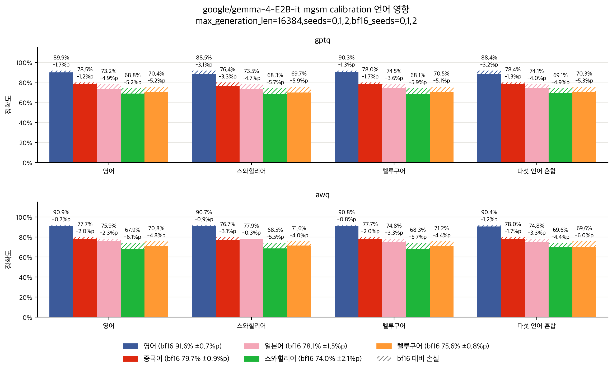
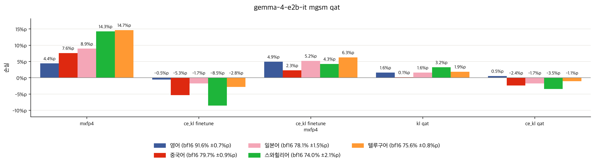

# multilingual quantization

## 배경
- 모델은 대부분 영어로 학습됨
- 따라서 양자화 모델은 영어가 아닌 언어에서 더 잃을 수 있음
- [the multilingual quantization tax](https://arxiv.org/abs/2608.09941)는 양자화하면 저자원 언어가 더 많이 잃는다고 보고
- 그러나 손실을 줄이는 방법은 다루지 않음
- 이 프로젝트는 손실이 어디서 생기는지 찾아 고치고, 양자화 모델이 bf16을 넘을 수 있는지 확인

## 요약

## 관련 연구
#### [the multilingual quantization tax](https://arxiv.org/abs/2608.09941)
- 양자화하면 저자원 언어가 더 많이 잃는다고 보고
- 그러나 nf4 하나로, thinking mode를 끄고 확인
- 이 프로젝트는 thinking mode를 켜고 여러 양자화 방법으로 다시 확인
#### [why do multilingual reasoning gaps emerge in reasoning language models](https://arxiv.org/abs/2510.27269)
- bf16에서 reasoning 시작에 영어 question을 삽입하면 언어 간 차이가 대부분 사라진다고 보고
- 그러나 양자화 모델은 보지 않음
- 이 프로젝트는 같은 방법을 양자화 모델에 적용

## 공통 설정
#### 용어
- prompt: instruction과 question
- reasoning: thinking mode에서 쓴 text
- response: reasoning 뒤 text
- understanding: reasoning 앞부분에서 question을 이해하는 부분
- solving: understanding 뒤 reasoning
- 해당 언어: question과 같은 언어
- 영어 question: 같은 문제의 영어 원문
- 삽입: reasoning 시작에 넣고, 이어서 모델이 씀
- 손실: bf16 정확도에서 양자화 모델 정확도를 뺀 값
- 넘음: 삽입 없는 bf16의 해당 언어 정확도보다 높음, 그림에서는 손실이 0 아래
- qat: 양자화한 채로 finetune
#### 모델
- qwen3.5-2b와 gemma-4-e2b-it, thinking mode를 켜고 bf16과 비교
- 양자화는 language model layer의 linear weight만 4 bit로
- 양자화 방법은 gptq, awq, nf4, mxfp4
- group size는 gptq와 awq 128, nf4 64, mxfp4 32
- gptq와 awq는 영어 wikipedia 2048 token chunk 128개로 calibration
#### 생성
- vllm 0.30.0, temperature 1.0, top-p 0.95
- qwen은 top-k 20, presence penalty 1.5, 최대 생성 길이 32768
- gemma는 top-k 64, 최대 생성 길이 16384
- seed 0, 1, 2 평균, 그림의 ±는 seed 사이 표준편차
#### 평가
- 언어는 영어, 중국어, 일본어, 스와힐리어, 텔루구어
- mgsm 250문제와 mmlu-prox-lite 588문제를 해당 언어 prompt로 zero shot
- instruction은 [simple-evals](https://github.com/openai/simple-evals/blob/main/mgsm_eval.py)와 [lm-evaluation-harness](https://github.com/EleutherAI/lm-evaluation-harness/blob/main/lm_eval/tasks/mmlu_prox/lang_libs.py)에서 가져옴
- 채점은 response만
- 설정에 따로 적지 않으면 위 값을 사용

## 실험

### 언어별 손실
- [the multilingual quantization tax](https://arxiv.org/abs/2608.09941)의 언어별 손실이 thinking mode를 켜도 나타나는지 확인
- bf16과 양자화 모델로 mgsm과 mmlu-prox-lite를 풀고, 언어마다 손실 비교
#### 설정
- 잘림: 최대 생성 길이에 닿고 틀린 문제
- 반복: reasoning 또는 response 끝에서 200~150번째 글자 50개가 그 앞에 5번 이상 나오는 문제
- mmlu-prox-lite는 bf16 seed 0, 1, 양자화 모델 seed 0
#### 결과

- gemma mgsm에서, 스와힐리어와 텔루구어가 가장 많이 잃음
- mmlu-prox-lite에서는, 영어보다 눈에 띄게 더 잃는 언어가 없음
- qwen은 양자화하면 많이 잘리고, 잘린 문제는 대부분 반복
- 따라서 이후 실험은 반복이 적은 gemma와 언어별 손실이 나타난 mgsm만 사용

### calibration 언어별 손실
- gptq와 awq는 calibration 언어에 따라 손실이 달라질 수 있음
- 해당 언어로도 calibration해 손실 비교
#### 설정
- 양자화 방법은 gptq, awq
- calibration 언어는 영어, 스와힐리어, 텔루구어, 다섯 언어 혼합
- 다섯 언어 혼합은 언어마다 chunk 25~26개
#### 결과

- gptq와 awq 모두, 해당 언어나 다섯 언어 혼합으로 calibration해도 스와힐리어와 텔루구어 손실이 눈에 띄게 줄지 않음
- 따라서 calibration 언어는 손실의 원인이 아님

### reasoning 위치별 kl
- 양자화 모델의 예측이 reasoning의 어디서 bf16과 가장 달라지는지 확인
- bf16 reasoning을 bf16과 양자화 모델에 똑같이 넣고, reasoning token마다 다음 token 예측의 kl 비교
#### 설정
- reasoning 위치: 문제마다 reasoning token을 5등분한 구간
- kl은 문제마다 token 평균을 낸 뒤 문제 평균
- reasoning은 bf16 seed 0
- 문제는 모든 bf16 seed가 맞힌 문제만
- reasoning 위치별 kl은 mxfp4만
#### 결과

- 스와힐리어와 텔루구어에서, 영어와의 kl 차이가 reasoning 위치 0~20%에서 가장 큼
- 따라서 스와힐리어와 텔루구어의 손실은 reasoning 앞부분에서 생길 수 있음

### understanding 삽입
- [reasoning 위치별 kl](#reasoning-위치별-kl)과 [오류 유형](EXPERIMENTS.md#오류-유형)에서, 양자화 모델은 reasoning 앞부분의 question 이해에서 bf16과 어긋남
- 그렇다면 gemma reasoning 앞부분에 있는 understanding 단계만 bf16 것으로 바꿔도 손실이 회복되는지 확인
- bf16 understanding을 양자화 모델에 삽입하고 손실 비교
#### 설정
- understanding은 같은 seed의 bf16이 해당 언어 prompt에 쓴 것
- understanding 구분: 제목에 calculate, determine, compute, solve, perform, set up, formulate가 처음 나오는 단계 앞까지
- bf16은 자기 understanding을 삽입해도 결과가 거의 같아서, 삽입 없는 bf16을 기준으로 사용
- 문제는 해당 언어와 영어 bf16 reasoning 모두에 understanding이 있는 문제만
- 문제 수는 seed마다 달라 그림에는 seed 평균
#### 결과

- mxfp4에서, understanding만 삽입해도 모든 언어에서 손실이 절반 넘게 줄어듦
- 스와힐리어와 텔루구어가 영어보다 더 잃는 정도도 크게 줄어듦
- [reasoning 앞부분 길이별 삽입](EXPERIMENTS.md#reasoning-앞부분-길이별-삽입)에서도, mxfp4 손실은 understanding 길이까지 크게 줄고 그 뒤로는 거의 그대로
- 따라서 손실은 solving보다 주로 understanding에서 생김

### 영어 question 삽입
- [영어 understanding 삽입](EXPERIMENTS.md#영어-understanding-삽입)에서, understanding만으로는 영어만큼 회복되지 않음
- 그렇다면 [why do multilingual reasoning gaps emerge in reasoning language models](https://arxiv.org/abs/2510.27269)처럼 영어 question 자체를 삽입하면, 양자화 모델도 더 회복되는지 확인
- 같은 문제의 영어 question을 bf16과 양자화 모델에 삽입하고 손실 비교
#### 설정
- 해당 논문과 달리 문장으로 감싸지 않고 영어 question만 삽입
- 문제는 모든 문제
#### 결과

- 모든 양자화 방법에서, 영어 외 모든 언어가 bf16을 넘음
- 따라서 양자화 모델도 영어 question을 받으면 해당 언어에서 bf16을 넘음

### qat
- [영어 question finetune](EXPERIMENTS.md#영어-question-finetune)에서, 영어 question과 그 뒤 reasoning을 함께 finetune하면 효과가 있음을 bf16에서 확인
- 그렇다면 이제 양자화 모델에서도 이 finetune으로 bf16을 넘는지 확인
- finetune 뒤 mxfp4로 양자화한 것과 qat의 손실 비교
#### 설정
- ce_kl: 영어 question은 ce, 그 뒤 reasoning은 같은 입력을 받은 bf16에 kl로 맞춤
- qat: forward는 mxfp4로 양자화한 weight, backward는 양자화를 건너뛰어 원래 weight를 업데이트
- kl qat: 영어 question 없이 해당 언어 reasoning만 같은 입력을 받은 bf16에 kl로 맞춰, 손실만 회복
- 학습 데이터는 gsm8k train 20000개, ce_kl은 영어 question finetune과 같음
- 양자화 방법은 mxfp4
#### 결과

- ce_kl finetune을 mxfp4로 양자화하면 모든 언어에서 다시 잃음
- kl qat는 mxfp4 손실을 대부분 회복하지만 bf16을 넘지 못함
- ce_kl qat는 영어 외 모든 언어에서 bf16을 넘음
- 따라서 양자화 모델이 bf16을 넘는 것은 손실 회복이 아니라 영어 question을 쓰도록 finetune한 덕분

---
- 전체 실험은 [EXPERIMENTS.md](EXPERIMENTS.md)
