# results

## common setup
all experiments use this setup unless noted
- qwen3.5-2b, gemma-4-e2b-it, thinking mode on
- bf16 baseline
- 4 bit, weights of linear layers only
- rtn, gptq, awq group size 128, nf4 group size 64, mxfp4 group size 32
- gptq, awq calibrate on 128 en wikipedia chunks, 2048 tokens each
- 5 languages (en, zh, sw, ja, te), prompts in each language, zero shot
- mgsm 250, mmlu-prox-lite 588 problems per language
- mgsm instructions from [simple-evals](https://github.com/openai/simple-evals/blob/main/mgsm_eval.py)
- mmlu-prox-lite instructions from [lm-evaluation-harness](https://github.com/EleutherAI/lm-evaluation-harness/blob/main/lm_eval/tasks/mmlu_prox/lang_libs.py)
- mgsm only after loss section
- gemma only after teacher forcing section, because it almost never loops, runs fast
- mxfp4 only after prefix swap section
- vllm 0.30.0, temperature 1.0, top-p 0.95
- qwen top-k 20, presence penalty 1.5, max generation len 32768
- gemma top-k 64, presence penalty 0, max generation len 16384
- mean of seed 0, 1, 2 unless noted
- prompt means instruction, question
- instruction means text before question
- reasoning means text in thinking mode
- response means text after reasoning
- score only response
- loop means the 50 characters from 200 to 150 before end of reasoning or response appear 5 or more times earlier

## loss
check if language matters, as paper says

#### setup
- truncated means it hit max generation len and got wrong answer
- wrong means it finished and got wrong answer
- use all problems, because qwen bf16 solved too few on sw, te
- on mmlu-prox-lite, seed 0, 1 for bf16, seed 0 for quantized models, because losses look similar across languages

#### summary
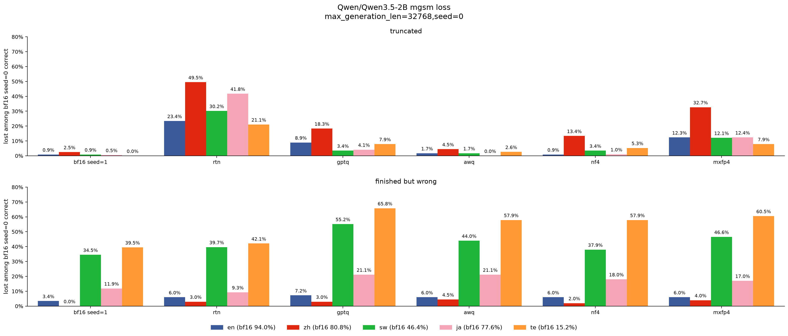
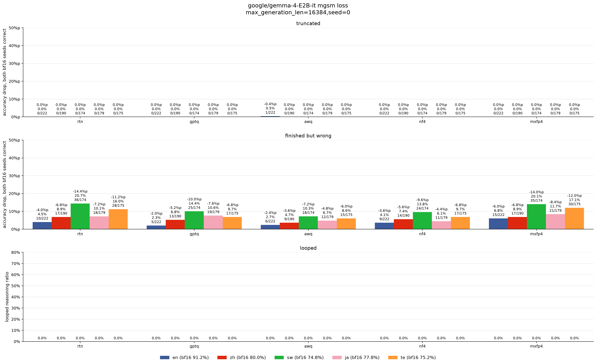
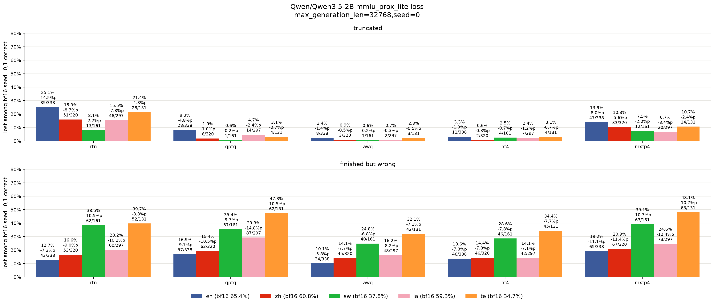
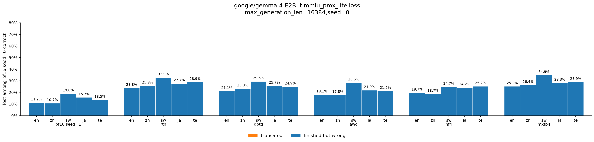
- on mgsm, awq loses least, and rtn, mxfp4 lose most
- on mgsm, gemma loses less than qwen
- on qwen mgsm, quantized models truncate a lot, mostly from loops
- on qwen mgsm, bf16 is weak on sw, te
- on gemma mgsm, models almost never truncate, so they lose through wrong answers
- **on gemma mgsm, sw, te lose most**
- on mmlu-prox-lite, no language clearly loses more than en

## calibration
check if calibration language matters, because calibration uses only en

#### setup
- awq only, because awq relies more on calibration
- mgsm only, because only mgsm shows a gap with en
- calibrate on en, sw, te, all
- all means en, zh, sw, ja, te with about 26 chunks each
- seed 0 only

#### summary
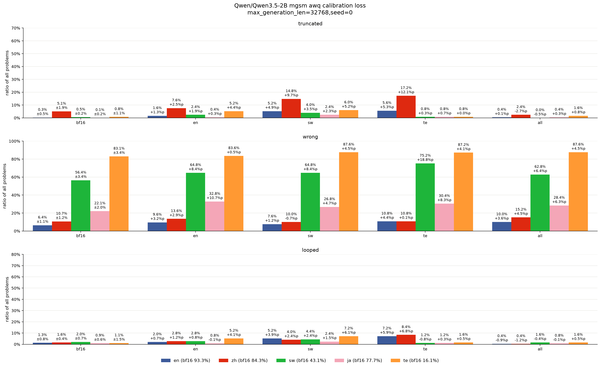
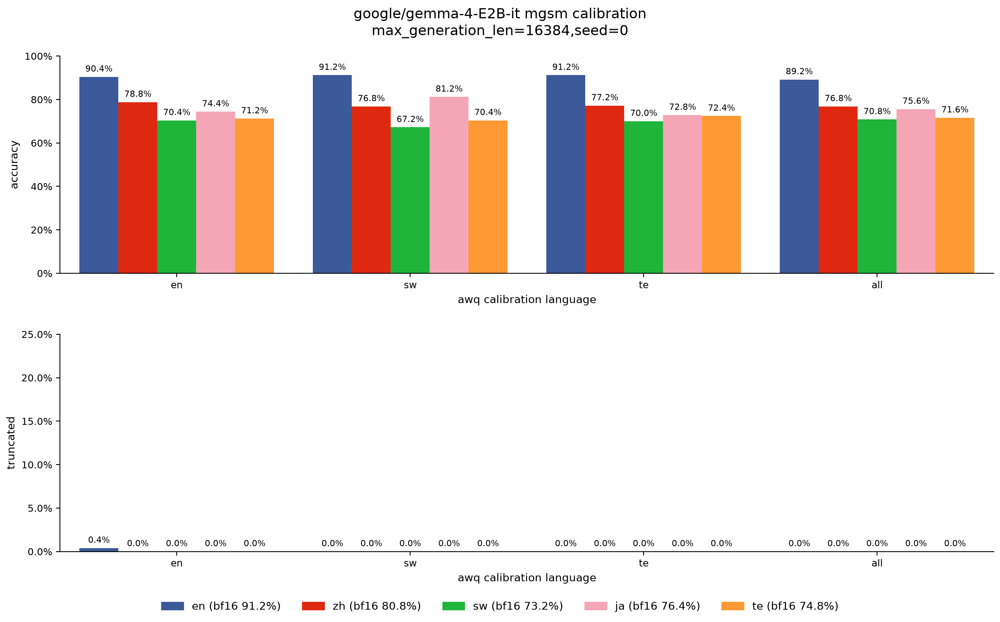
- **on sw, te, calibrating on their own language does not clearly help**
- on qwen, calibrating on all may help
- on gemma, calibrating on all does not help

## teacher forcing
check if prediction changes differ by language

#### setup
- take bf16 seed 0 reasoning on problems solved by bf16 seed 0, 1
- give that reasoning to bf16, quantized
- compare their next token predictions with kl at each reasoning position
- kl by reasoning progress is awq only

#### summary
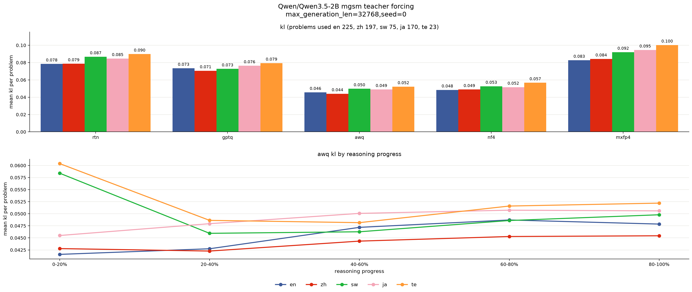
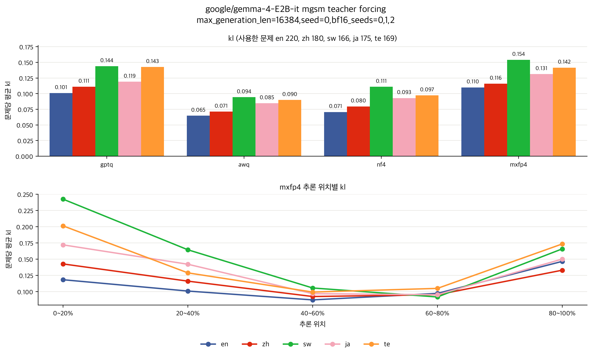
- on qwen, kl does not match loss
- on gemma, kl matches loss between languages, but not clearly between methods
- **on gemma sw, te, kl gap with en is largest at start of reasoning**

## prefix swap
check if quantization hurts reading or solving, because kl gap with en is largest at start of reasoning

#### setup
- awq, mxfp4 only, because awq loses least, and mxfp4 loses most
- take saved reasoning of bf16 or quantized
- prefix means that reasoning up to line where all question numbers have appeared
- continue after prefix with bf16 or quantized, so four cases
- reading means prefix
- solving means everything after prefix
- use problems that have prefix in all four cases

#### summary
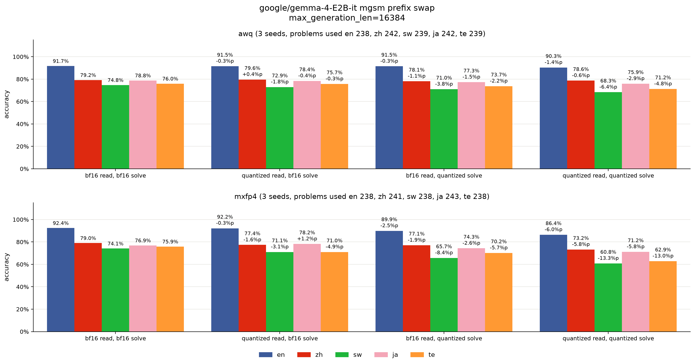
- **on sw, te, neither reading nor solving is the only cause of loss**

## reasoning swap
check if whole reasoning matters, because neither reading nor solving is the only cause of loss

#### setup
- take saved reasoning of bf16 or quantized on problems that reached response, correct or not
- write response after it with bf16 or quantized, so four cases

#### summary
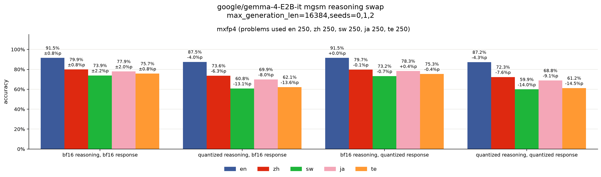
- **reasoning decides accuracy, not response**

## error types
check how, where reasoning goes wrong, because reasoning decides accuracy, not response

#### setup
- wrong reasoning means quantized reasoning on problems it got wrong
- take wrong reasoning on problems solved by all bf16 seeds
- give wrong reasoning, bf16 reasoning to qwen3.5-27b
- qwen3.5-27b picks first wrong line, error type
- fact means a number, unit, word, name is copied wrong
- relation means a relation between quantities is read wrong
- question means it answers a different question
- doubt means a given condition is called missing, then dropped
- arithmetic means setup is right, but computation is wrong
- other means none of these

#### summary
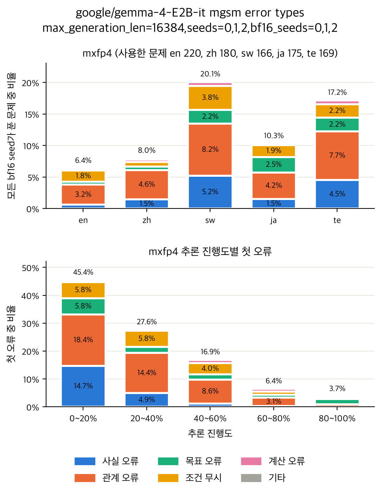
- **on sw, te, errors are mostly fact, relation, not arithmetic, so they may mostly copy, read question wrong**
- on [prefix swap](#prefix-swap), reading was not the only cause of loss, but prefix only tracks question numbers, so it may be too rough
- on sw, te, first errors mostly come in first 60% of reasoning
- on claude opus 5.5, types differ in places, but overall pattern looks similar

## translation
check if translating first, then solving separately helps, because sw, te may mostly copy, read question wrong

#### setup
- translate each question into en with bf16 or quantized
- give translation instruction in en
- solve translation with bf16 or quantized, with en instruction, so four cases
- solving means reasoning, response on translated question
- use problems that have translation in all four cases
- solving directly means quantized reasoning, quantized response of reasoning swap

#### summary
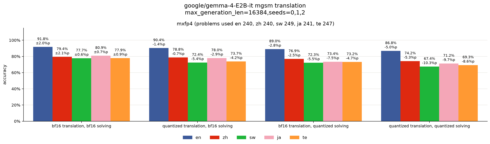
- on sw, te, quantized translation, quantized solving lose about equally, so translation is not the only cause of loss
- **on sw, te, translating first, then solving separately gives higher accuracy than solving directly**

## instruction language
check if en instruction is why solving separately gives higher accuracy, because solving separately also changes instruction to en

#### setup
- en instruction means question stays in each language, but instruction is in en
- native instruction means instruction in each language
- compare en instruction with native instruction

#### summary
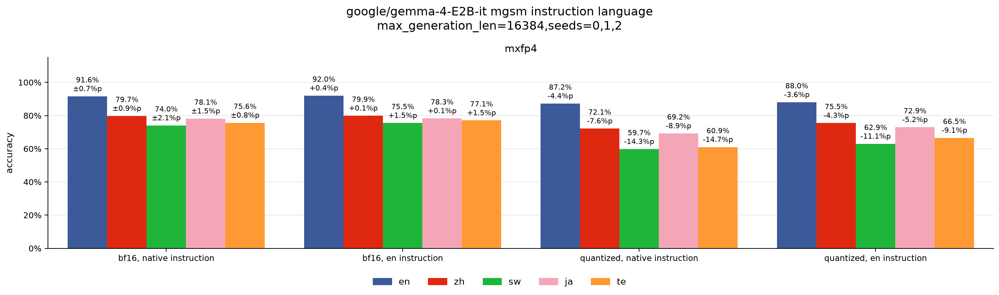
- **on quantized sw, te, en instruction raises accuracy, but less than solving separately, so quantized model may lose more with more non-en text**
- on bf16 sw, te, en instruction raises accuracy less than on quantized

## translate first
check if adding translation step to instruction helps, because translating first, then solving separately gives higher accuracy

#### setup
- translate first instruction means en instruction that asks to write question in en first, then solve
- compare translate first instruction with en instruction, because this checks only effect of translation step

#### summary
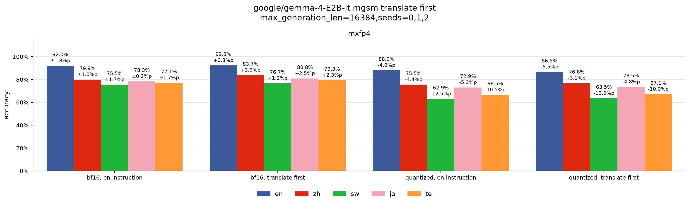
- **on quantized sw, te, translate first instruction does not clearly help**
- on bf16 zh, ja, te, translate first instruction raises accuracy, but not clearly on sw

## hidden error
check if sw, te go wrong before reasoning, not only by errors building up in reasoning, because quantized model may lose more with more non-en text

#### setup
- use en instruction
- give same prompt to bf16, quantized, without generation
- hidden error means distance between bf16, quantized hidden of each layer, divided by norm of bf16 hidden
- use all problems, no seeds, because there is no generation

#### summary
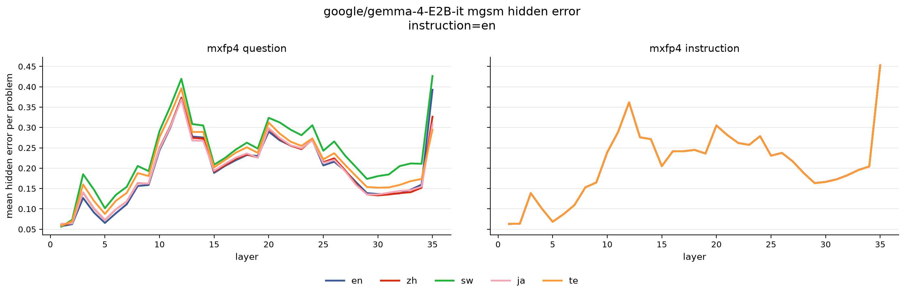
- **on sw, te, hidden error is higher than en before reasoning, from layer 3, and they lose much more**
- on zh, ja, hidden error is similar to en before reasoning, and they lose slightly more

## layer swap
check which layers are sensitive, because on sw, te, hidden error is higher than en from layer 3

#### setup
- use en instruction
- recovery means quantized model with one layer range from bf16
- damage means bf16 model with one layer range from quantized
- layer ranges are 1~3, 4~6, 7~9, 10~12, 13~15, 16~35
- 16~35 is one range, because these layers reuse key, value of layers 14, 15

#### summary
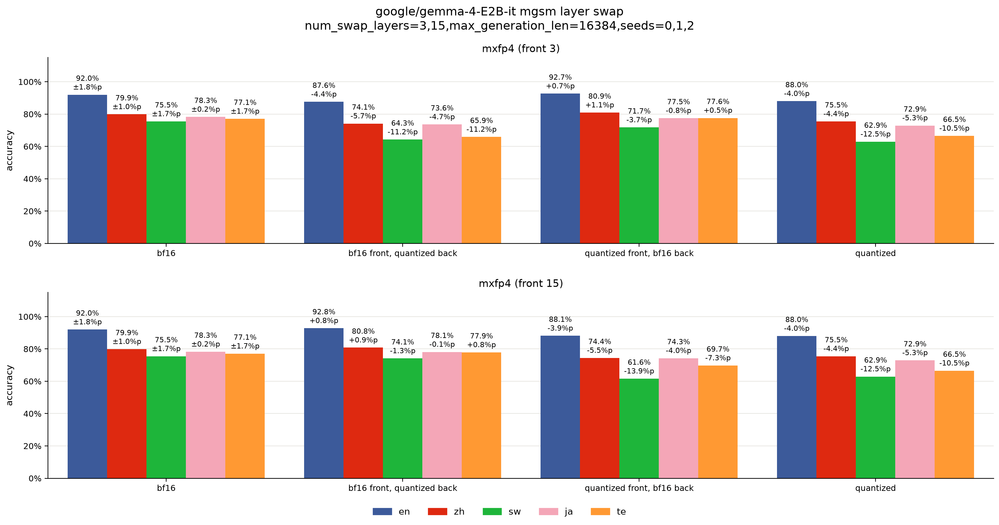
- **on sw, te, no single layer range clearly matters**

## read like en qat
check if qat does better by following bf16 reasoning on en prompt, because sw, te may mostly copy, read question wrong

#### setup
- use gsm8k train questions from [mcot](https://huggingface.co/datasets/laihuiyuan/mCoT-MATH) in 5 languages, because gsm8k problems are similar to mgsm problems, so training may carry over to mgsm
- bf16 same prompt means bf16 gets same prompt as quantized model
- bf16 en prompt means bf16 gets en prompt
- take bf16 seed 0 reasoning on prompt that bf16 gets
- give that reasoning to bf16, quantized
- match quantized next token predictions to bf16 with kl at each reasoning position
- train from bf16 weights with mxfp4 rounding
- adamw lr 1e-5, no weight decay, cosine schedule, 5% warmup, batch size 8, 1 epoch, max sequence len 2048
- compare bf16 same prompt with bf16 en prompt
- use problems solved by bf16 seed 0 in en

#### summary
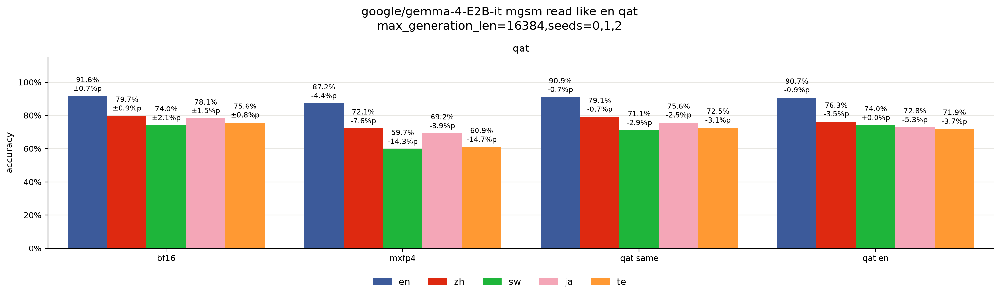
- **on sw, te, qat with kl recovers most of loss, so bf16 en prompt is hard to tell apart from bf16 same prompt**
- we do not know yet if training can go above bf16

## translate first finetune
check if training to write en question first goes above bf16, because on bf16 zh, ja, te, translate first instruction raises accuracy

#### setup
- translate first finetune means bf16 trained to write en question at start of reasoning
- use gsm8k train questions from mcot in zh, sw, ja, te
- use native instruction
- put en question of same problem before bf16 seed 0 reasoning on en prompt
- match next token predictions to en question, reasoning with cross entropy, not kl, because en question comes from gsm8k, not from bf16
- train from bf16 weights without rounding
- adamw lr 1e-5, no weight decay, cosine schedule, 5% warmup, batch size 8, 1 epoch, max sequence len 2048
- compare translate first finetune with bf16 native instruction, bf16 translate first instruction
- use problems solved by bf16 seed 0 in en

#### summary
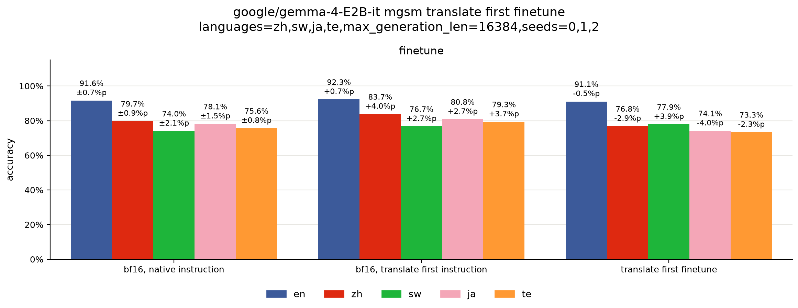
- **translate first finetune writes en question at start of reasoning, but does not clearly raise accuracy**
