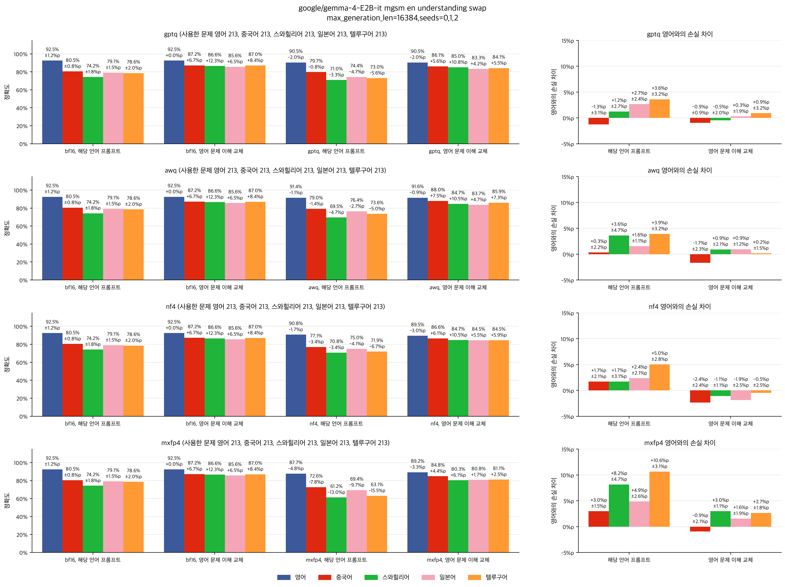
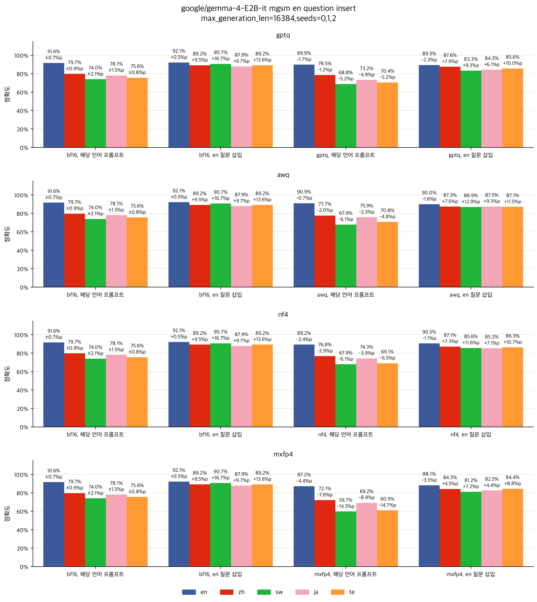

# 결과

## 공통 설정

#### 용어
- 프롬프트: 지시문, 질문
- 지시문: 질문 앞 텍스트
- 질문: 문제의 텍스트
- 추론: thinking mode에서 쓴 텍스트
- 응답: 추론 뒤 텍스트
- 해당 언어: 문제와 같은 언어
- 손실: bf16보다 떨어진 정확도
- 잘림: 최대 생성 길이에 닿고 틀린 문제
- 반복: 같은 글을 되풀이한 문제, 추론이나 응답 끝에서 200~150번째 글자 50개가 그 앞에 5번 이상 나오는지로 판단
- 문제 이해: 추론 시작에서 목표와 주어진 정보를 en으로 쓰는 부분, 추론의 약 1/4
- 풀이: 문제 이해 뒤 추론

#### 범위
- 따로 적지 않으면 모든 실험에 적용
- 언어별 손실 이후로는 mgsm만, mmlu-prox-lite에서는 en보다 눈에 띄게 더 잃는 언어가 없기 때문
- 언어별 손실 이후로는 gemma만, gemma는 거의 반복하지 않아 손실만 보기 좋기 때문

#### 모델
- qwen3.5-2b, gemma-4-e2b-it, thinking mode 사용
- bf16 기준
- 4 bit, linear layer weight만 양자화
- gptq, awq group size 128, nf4 group size 64, mxfp4 group size 32
- gptq, awq는 en wikipedia chunk 128개로 calibration, chunk마다 2048 token

#### 생성
- vllm 0.30.0, temperature 1.0, top-p 0.95
- qwen top-k 20, presence penalty 1.5, 최대 생성 길이 32768
- gemma top-k 64, presence penalty 0, 최대 생성 길이 16384
- 따로 적지 않으면 seed 0, 1, 2 평균

#### 평가
- en, zh, sw, ja, te, 해당 언어 프롬프트, zero shot
- 언어마다 mgsm 250개, mmlu-prox-lite 588개 문제
- mgsm 지시문은 [simple-evals](https://github.com/openai/simple-evals/blob/main/mgsm_eval.py)에서 가져옴
- mmlu-prox-lite 지시문은 [lm-evaluation-harness](https://github.com/EleutherAI/lm-evaluation-harness/blob/main/lm_eval/tasks/mmlu_prox/lang_libs.py)에서 가져옴
- 추론이 아니라 응답만 채점

## 언어별 손실
[the multilingual quantization tax](https://arxiv.org/abs/2608.09941)에서 말한 대로 언어마다 손실이 다른지 확인

#### 설정
- mmlu-prox-lite는 bf16 seed 0, 1, 양자화 모델 seed 0, 언어마다 손실이 비슷해 보이기 때문
- 모든 문제 사용, qwen bf16이 sw와 te에서 푼 문제가 너무 적기 때문

#### 요약

- mgsm에서, awq가 가장 적게 잃고 mxfp4가 가장 많이 잃음
- mgsm에서, gemma가 qwen보다 적게 잃음
- qwen mgsm에서, 양자화 모델이 많이 잘리고 그 대부분이 반복
- qwen nf4와 mxfp4 mgsm에서, zh가 크게 잃고 그 대부분이 잘림
- qwen bf16 mgsm에서, sw와 te가 약함
- gemma mgsm에서, 거의 잘리지 않음, 따라서 손실은 대부분 틀린 응답에서 발생
- **gemma mgsm에서, sw와 te가 가장 많이 잃음**
- gemma mgsm에서, ja도 en보다 더 잃음, 그러나 sw와 te보다 적음
- mmlu-prox-lite에서, en보다 눈에 띄게 더 잃는 언어 없음

## calibration 언어 민감도
calibration 언어가 중요한지 확인

#### 설정
- all: en, zh, sw, ja, te, 언어마다 chunk 약 26개
- awq만, 직관적으로 awq가 calibration에 더 의존하기 때문
- en, sw, te, all로 calibration

#### 요약

- **sw와 te에서, 해당 언어로 calibration해도 눈에 띄게 나아지지 않음**
- all로 calibration해도 눈에 띄게 나아지지 않음

## 추론 위치별 예측 차이
언어마다 양자화로 예측이 얼마나 바뀌는지 확인

#### 설정
- 추론 위치: 추론에서 어디쯤인지, 문제마다 추론 token을 5등분한 구간
- 추론 위치별 kl은 mxfp4만
- 모든 bf16 seed가 푼 문제에서 bf16 seed 0 추론 추출
- 그 추론을 bf16과 양자화 모델에 입력
- 추론 위치마다 두 모델의 다음 token 예측을 kl로 비교

#### 요약

- 언어 사이에서는 kl 순서가 손실 순서와 맞음, 그러나 방법 사이에서는 눈에 띄게 맞지 않음
- **sw와 te에서, en과의 kl 차이가 추론 시작에서 가장 큼**

## 추론 교체
[추론 위치별 예측 차이](#추론-위치별-예측-차이)에서 sw와 te의 en과의 kl 차이가 추론 시작에서 가장 큼, 따라서 먼저 추론 전체를 바꿔서 추론이 정확도를 결정하는지 확인

#### 설정
- bf16 또는 mxfp4가 저장한 추론 추출, 정답 여부와 상관없음
- 그 추론에 이어서 bf16 또는 mxfp4로 응답 생성, 조합 4개

#### 요약

- **응답이 아니라 추론이 정확도를 결정**

## 오류 유형
[추론 교체](#추론-교체)에서 응답이 아니라 추론이 정확도를 결정, 따라서 추론이 어떻게, 어디서 틀리는지 확인

#### 설정
- 사실 오류: 문제의 숫자, 단위, 단어, 이름을 잘못 옮김
- 관계 오류: 양 사이의 관계를 잘못 읽음
- 목표 오류: 묻는 것과 다른 양을 구함
- 조건 무시: 주어진 조건을 없다고 하고 버림
- 계산 오류: 식은 맞지만 계산이 틀림
- 기타: 위에 없음
- 모든 bf16 seed가 푼 문제에서 틀린 추론 추출
- 틀린 추론과 bf16 추론을 qwen3.5-27b에 입력
- qwen3.5-27b가 처음 틀린 줄과 오류 유형 선택

#### 요약

- **sw와 te에서, 오류는 계산 오류가 아니라 대부분 사실 오류와 관계 오류**, 따라서 질문을 잘못 이해한 것일 수 있음
- 첫 오류는 대부분 추론 앞 60%에서 발생
- 사실 오류는 대부분 추론 앞 20%에서 발생

## en 문제 이해 교체
[오류 유형](#오류-유형)에서 sw와 te 오류는 대부분 사실 오류와 관계 오류이고 추론 시작에서 발생, 따라서 그 문제 이해만 바꿔도 en과의 차이를 메우는지 확인

#### 설정
- en 문제 이해: en 프롬프트에 대한 bf16 추론에서 제목에 calculate, determine, compute, solve, perform, set up, formulate가 처음 나오는 단계 앞까지
- 해당 언어 프롬프트 뒤, 추론 시작에 en 문제 이해 입력
- 이어서 bf16 또는 양자화 모델로 풀이와 응답 생성
- 해당 언어 프롬프트만 넣었을 때와 비교
- en 문제 이해가 있는 문제만 사용

#### 요약

- **각 양자화 방법에서, en 문제 이해 교체가 en과의 차이를 대부분 메움**, 따라서 en과의 차이는 풀이가 아니라 대부분 문제 이해에서 발생
- bf16에서도 en 문제 이해 교체가 en과의 차이를 대부분 메움

## en 질문 삽입
[en 문제 이해 교체](#en-문제-이해-교체)에서 en과의 차이는 대부분 문제 이해에서 발생, 따라서 bf16 문제 이해 없이 en 질문만 넣어도 en과의 차이를 메우는지 확인

#### 설정
- 해당 언어 프롬프트 뒤, 추론 시작에 같은 문제의 en 질문 입력
- 이어서 bf16 또는 양자화 모델로 추론과 응답 생성
- 해당 언어 프롬프트만 넣었을 때와 비교

#### 요약

- **각 양자화 방법에서, en 질문 삽입도 en과의 차이를 대부분 메움**, 따라서 en과의 차이는 대부분 해당 언어 질문을 읽는 데서 발생
- bf16에서도 en 질문 삽입이 en과의 차이를 대부분 메움
