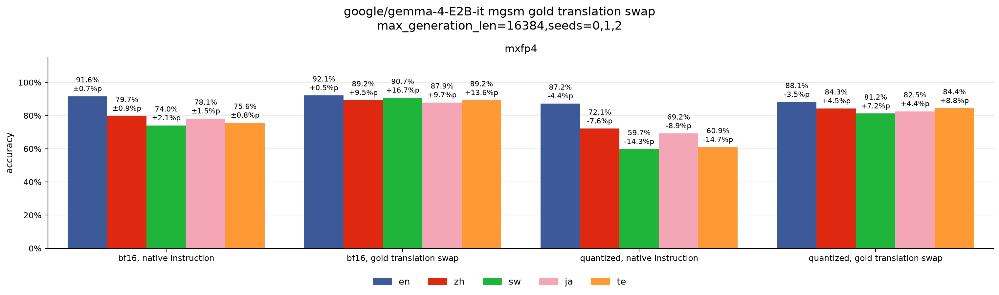

# results

## common setup
all experiments use this setup unless noted
- qwen3.5-2b, gemma-4-e2b-it, thinking mode on
- bf16 baseline
- 4 bit, weights of linear layers only
- gptq, awq group size 128, nf4 group size 64, mxfp4 group size 32
- gptq, awq calibrating on 128 en wikipedia chunks, 2048 tokens each
- 5 languages (en, zh, sw, ja, te), prompts in each language, zero shot
- mgsm 250, mmlu-prox-lite 588 problems per language
- mgsm instructions from [simple-evals](https://github.com/openai/simple-evals/blob/main/mgsm_eval.py)
- mmlu-prox-lite instructions from [lm-evaluation-harness](https://github.com/EleutherAI/lm-evaluation-harness/blob/main/lm_eval/tasks/mmlu_prox/lang_libs.py)
- vllm 0.30.0, temperature 1.0, top-p 0.95
- qwen top-k 20, presence penalty 1.5, max generation len 32768
- gemma top-k 64, presence penalty 0, max generation len 16384
- mean of seed 0, 1, 2 unless noted
- mgsm only after loss section, because on mmlu-prox-lite, no language clearly loses more than en
- gemma only after loss section, because it almost never loops, and qwen bf16 is weak on sw, te
- mxfp4 only after teacher forcing section, because it loses most
- prompt means instruction, question
- instruction means text before question
- question means text of problem
- reasoning means text in thinking mode
- translation means part at start of reasoning that writes question in en
- solving means reasoning after translation
- response means text after reasoning
- score only response

## loss
check if language matters, as paper says

#### setup
- on mmlu-prox-lite, seed 0, 1 for bf16, seed 0 for quantized models, because losses look similar across languages
- truncated means it hit max generation len and got wrong answer
- loop means the 50 characters from 200 to 150 before end of reasoning or response appear 5 or more times earlier
- use all problems, because qwen bf16 solved too few on sw, te

#### summary

- on mgsm, awq loses least, and mxfp4 loses most
- on mgsm, gemma loses less than qwen
- on qwen mgsm, quantized models truncate a lot, mostly from loops
- on qwen mgsm, bf16 is weak on sw, te
- on gemma mgsm, models almost never truncate, so they lose through wrong answers
- **on gemma mgsm, sw, te lose most**
- on mmlu-prox-lite, no language clearly loses more than en

## calibration
check if calibration language matters

#### setup
- awq only, because intuitively awq relies more on calibration
- seed 0 only
- calibrating on en, sw, te, all
- all means en, zh, sw, ja, te with about 26 chunks each

#### summary

- **on sw, te, calibrating on their own language does not clearly help**
- calibrating on all does not help

## teacher forcing
check if prediction changes differ by language

#### setup
- kl by reasoning progress is awq only
- take bf16 seed 0 reasoning on problems solved by bf16 seed 0, 1
- give that reasoning to bf16, quantized
- compare their next token predictions with kl at each reasoning position

#### summary

- kl matches loss between languages, but not clearly between methods
- **on sw, te, kl gap with en is largest at start of reasoning**

## reasoning swap
[teacher forcing](#teacher-forcing) shows kl gap with en is largest at start of reasoning, so check if reasoning or response decides accuracy

#### setup
- take saved reasoning of bf16 or quantized on problems that reached response, correct or not
- write response after it with bf16 or quantized, so four cases

#### summary

- **reasoning decides accuracy, not response**

## error types
[reasoning swap](#reasoning-swap) shows reasoning decides accuracy, not response, so check how, where reasoning goes wrong

#### setup
- wrong reasoning means quantized reasoning on problems it got wrong
- fact means a number, unit, word, name is copied wrong
- relation means a relation between quantities is read wrong
- target means it solves for a different quantity than asked
- doubt means a given condition is called missing, then dropped
- arithmetic means setup is right, but computation is wrong
- other means none of these
- take wrong reasoning on problems solved by all bf16 seeds
- give wrong reasoning, bf16 reasoning to qwen3.5-27b
- qwen3.5-27b picks first wrong line, error type

#### summary

- **on sw, te, errors are mostly fact, relation, not arithmetic, so they may mostly copy, read question wrong**
- first errors mostly come in first 60% of reasoning
- fact errors mostly come in first 20% of reasoning
- on claude opus 5.5, types differ in places, but overall pattern looks similar

## gold translation swap
[error types](#error-types) shows sw, te may mostly read question wrong, so check if gap with en comes from translation or from solving

#### setup
- native instruction means instruction in each language
- gold translation means mgsm en question
- gold translation swap means gold translation put at start of reasoning, after prompt with native instruction
- continue solving, response after gold translation with bf16 or quantized
- compare gold translation swap with native instruction

#### summary

- **on zh, sw, ja, te, gold translation swap closes most of gap with en, so gap with en mostly comes from translation, not from solving**
- i do not know yet if model can write translation close to gold translation
